# K–12 Knowledge Graph (Mathematics + Chinese Language Arts + English + Physics)

Aligned with the **required and selective-compulsory** components of the *Compulsory Education Mathematics Curriculum Standards (2022 Edition, Revised in 2025)* (issued under the Ministry of Education's *Routine Revision of the National Curriculum Plan and Curriculum Standards*, Textbook [2025] No. 1) and the *General Senior High School Mathematics Curriculum Standards (2017 Edition, Revised in 2025)*; Levels 1, 2, and 3 (Grades 7–9) of the *Compulsory Education English Curriculum Standards (2022 Edition)*; and the required and selective-compulsory components of the *General Senior High School English Curriculum Standards (2017 Edition, Revised in 2025)*. The mathematics textbooks are the People's Education Press (PEP) editions for Grades 1–9, the PEP A Edition (2019) two required volumes, and three selective-compulsory volumes. English follows PEP from Grade 3 through the first semester of Grade 6 (the new editions for the second semester of Grades 5 and 6 have not launched, so the old editions are used for now), the new PEP Go for it! from the first semester of Grade 7 through the first semester of Grade 9 (the new second-semester Grade 9 edition has not launched, so the old complete Grade 9 volume, including Units 9–14, is used for now), and the PEP (2019) three senior-high required volumes and four selective-compulsory volumes. Junior-high physics follows the new PEP editions (revised according to the 2022 curriculum standards) for the first and second semesters of Grade 8 and the complete Grade 9 volume, aligned with the *Compulsory Education Physics Curriculum Standards (2022 Edition, Revised in 2025)*. Senior-high physics follows the PEP (approved in 2019) required Volumes 1–3 and selective-compulsory Volumes 1–3, aligned with the *General Senior High School Physics Curriculum Standards (2017 Edition, Revised in 2020)*. The project includes **adaptive prerequisite diagnostics** and a question bank. A wrong mathematics answer follows prerequisite edges back from high school through middle school to the specific primary-school knowledge point. English has its own graph and no edges to mathematics; junior-high English links back to primary English, and senior-high English links mainly to junior-high English. Physics also has its own graph; related mathematics is recorded in each knowledge point's `mathLinks` field and does not count as a prerequisite edge. The repository name remains `12grades`.

**Scope: Senior-high mathematics covers required and selective-compulsory content and uses only the People's Education Press A Edition (2019); English covers Grade 3 through senior high school (the PEP 2019 three required volumes and four selective-compulsory volumes). This is an AI-generated first draft.** Section 7.3, “Trigonometric Representation of Complex Numbers,” is still treated as optional textbook material and has no separate node. Definite integrals are not included in the selective-compulsory content requirements and have no node. English has no listening or speaking questions.

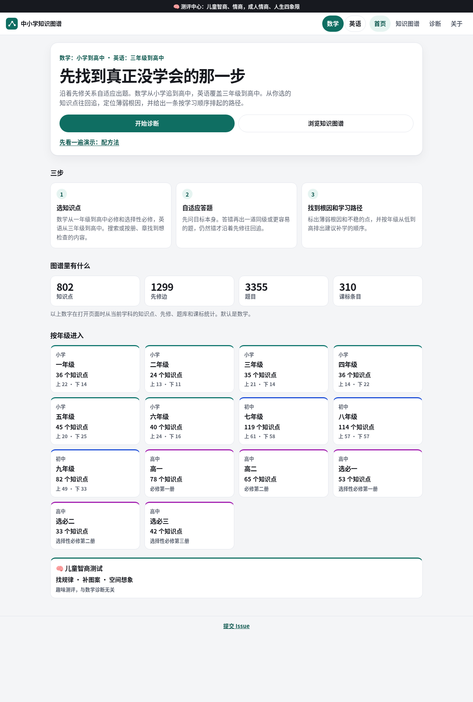

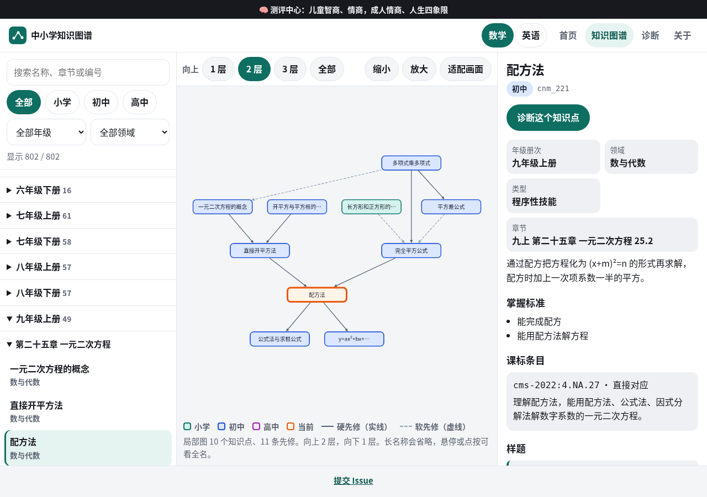

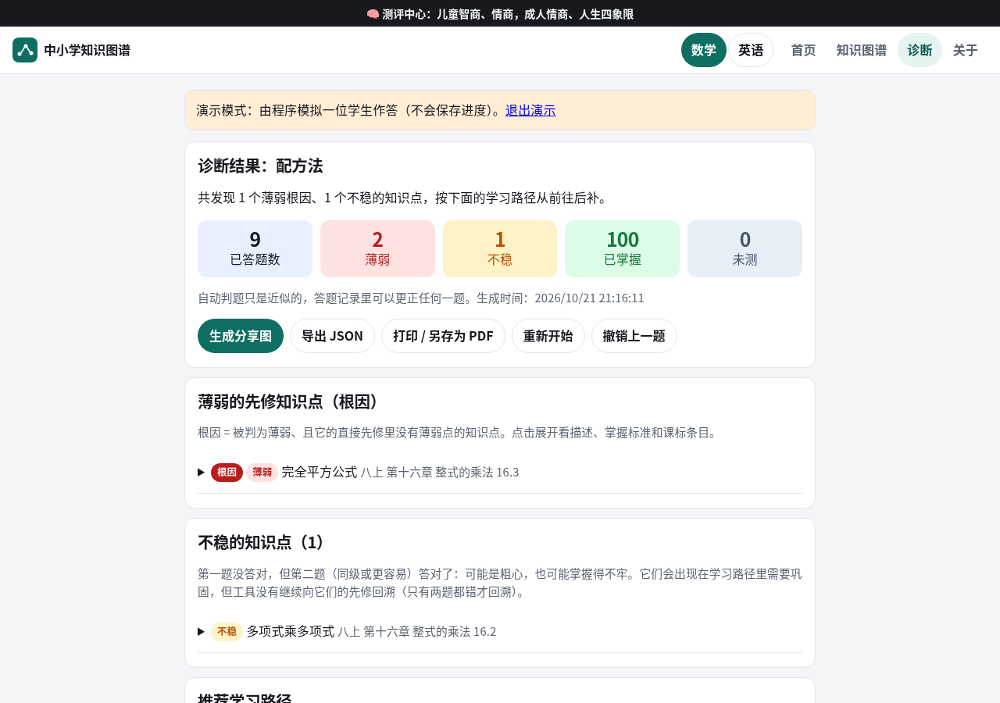

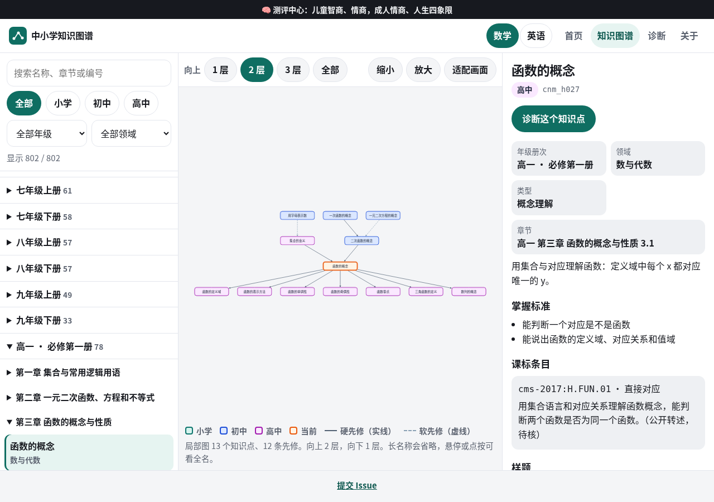

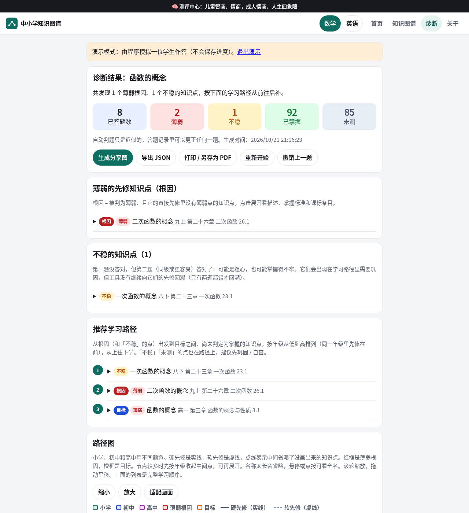

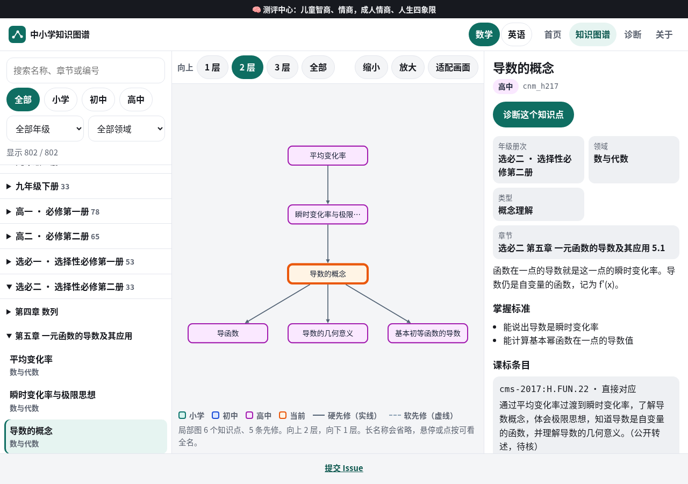

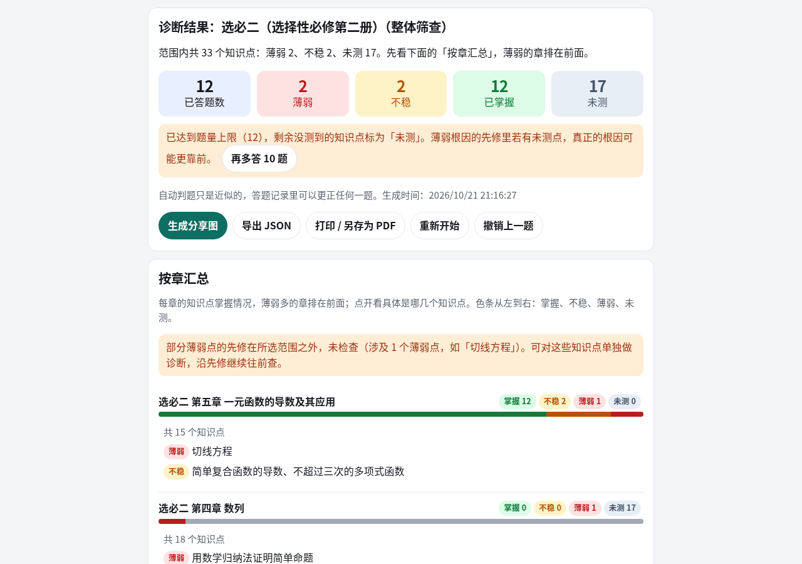

| | Knowledge points | Prerequisite edges | Curriculum-standard entries | Question bank |
| --- | ---: | ---: | ---: | ---: |
| Primary school (Grades 1–6) | 253 | 397 (internal to primary school) | 77 (Stages 1–3; 4 added under the 2025 revision on 2026-10-21) | 1012 |
| Junior high (Grades 7–9) | 315 | 563 (internal to junior high; unchanged) | 157 (Stage 4) | 1407 |
| Senior-high required | 143 | 144 (internal to senior-high required) | 48 (2017 required; pending verification) | 572 |
| Senior-high selective compulsory | 128 | 148 (internal to selective compulsory) | 32 (2017 selective compulsory; pending verification) | 512 |
| Mathematics total | 839 | 1397 (plus 45 junior-high → primary, 54 required cross-stage, and 46 selective-compulsory cross-module edges) | 314 | 3503 |
| Primary English (Grades 3–6) | 208 | 254 (hard 60, soft 194; no links to mathematics) | 35 (English Levels 1 and 2, 2022; all pending verification) | 832 |
| Junior-high English (Grades 7–9) | 257 | 361 (hard 117, soft 244; 29 hard edges point to primary English) | 37 (English Level 3, 2022; all pending verification) | 1028 |
| Senior-high English (3 required and 4 selective-compulsory volumes) | 259 | 299 (hard 44, soft 255; 22 edges point to junior-high English) | 44 (senior-high English, 2017; all pending verification) | 1036 |
| Junior-high physics (Grade 8 first and second semesters; complete Grade 9 volume) | 92 | 123 (hard 100, soft 23; no links to mathematics; 34 additional `mathLinks`) | 89 (2022 Edition, Revised in 2025; checked after OCR) | 368 |
| Senior-high physics (3 required and 3 selective-compulsory volumes) | 177 | 514 (hard 277, soft 237; 105 edges point to junior-high physics; no links to mathematics; 64 additional `mathLinks`) | 108 (2017 Edition, Revised in 2020: 87 content requirements + 21 required student experiments; pending verification) | 708 |

Data format follows [Marble os-taxonomy](https://github.com/withmarbleapp/os-taxonomy) (`topics` + `dependencies`).

> **Status: This is an AI-generated first draft and has not been reviewed by any teachers.** This applies to primary-, junior-high-, and senior-high mathematics, and to primary-, junior-high-, and senior-high English.
> The granularity of knowledge-point breakdowns, mastery criteria, and diagnostic answers—and especially **prerequisite relationships (which edges are hard or soft, or whether an edge should exist at all)—must be reviewed by practicing teachers** before the material is used for instruction, diagnostics, or learning-path recommendations. Primary- and junior-high mathematics diagnostic questions have automated checks; junior-high mathematics also has a blind-solve review, and primary mathematics has an independent programmatic review. **Senior-high and English questions have not had a blind-solve review**; each `verify` expression and its answer come from the same expression. Most primary textbook volume tables, senior-high curriculum-standard text, and senior-high chapter tables have not been checked page by page against official sources. The English curriculum-standard text, the PEP and Go for it! unit tables, and the PEP (2019) senior-high English unit table have not been checked page by page. The data value `待核` means “pending verification”; it should not be treated as official wording or as a page reference.
>
> **Volume labels:** PEP A Edition required Volume 2 is usually taught in the second semester of Grade 10. To assign the two volumes to two separate `grade` values, this repository labels required Volume 1 as grade 10 and required Volume 2 as grade 11 (compulsory). The three selective-compulsory volumes use grades 12, 13, and 14; the UI does not label them “Senior High Year 3” or “Senior High Year 4.” Senior-high English grades 10–12 are required Volumes 1–3, and grades 13–16 are selective-compulsory Volumes 1–4. The UI labels these as Compulsory Volumes 1–3 and Selective-Compulsory Volumes 1–4, not by high-school year. These labels do not prescribe teaching schedules and should be adjusted by teachers.

## Data Sources and Alignment

- **Curriculum standards:** Publicly available paraphrases of the Content Requirements for Stages 1–4 (Grades 1–9) in the Ministry of Education's *Compulsory Education Mathematics Curriculum Standards (2022 Edition)*, and of the five required themes and selective-compulsory themes (Functions; Geometry and Algebra; Probability and Statistics; Mathematical Modeling and Mathematical Inquiry) in the *General Senior High School Mathematics Curriculum Standards (2017 Edition, Revised in 2025)*. `data/cn-curriculum-standards.json` currently contains **314** entries (234 compulsory-education + 48 senior-high required + 32 senior-high selective-compulsory). The primary-school portion was reviewed against the 2022 edition revised in 2025 on 2026-10-21, and omitted clauses were added (see [docs/moe2025-alignment.md](docs/moe2025-alignment.md)); `source.revision*` records the current edition and scope of review. Stage 4 wording remains as originally identified from the Ministry of Education PDF. Entries for Stages 1–3 and senior high school have **not** been checked page by page against the Ministry of Education PDF; all senior-high entries have `verbatim: false` and `page_or_ref` set to the data value `待核` (“pending verification”). Sources, rules, coverage, and limitations are documented in [docs/standards-mapping.md](docs/standards-mapping.md). Senior-high IDs are local to this graph: `cms-2017:H.<PRE|FUN|GA|PS|MI>.NN`; they are not Ministry of Education IDs.
- **Textbook sequence:** PEP mathematics textbooks for compulsory education. **Junior high** uses the 2024-approved new edition. Chapter tables come from the third-party e-textbook directory site dzskb.com (not an official PEP site); verification status follows (see “Primary-School Volume Tables” below for the primary volumes):

  | Volume | Directory used | Verification status |
  |---|---|---|
  | Grade 7, Volume 1 | Chapter 1, Rational Numbers … Chapter 6, Introduction to Geometric Figures | **Verified against an official source:** On 2026-10-22, checked the contents-page preview on the National Smart Education Platform for Primary and Secondary Schools; the title says “Revised according to the 2022 edition of the curriculum standards” (PEP book ID 540ac93d). Chapters and sections match this graph. |
  | Grade 7, Volume 2 | Chapter 7, Intersecting and Parallel Lines … Chapter 12, Collecting, Organizing, and Describing Data | **Verified against an official source:** On 2026-10-22, checked the contents-page preview on the National Smart Education Platform for Primary and Secondary Schools; the title says “Revised according to the 2022 edition of the curriculum standards” (PEP book ID 81d65033). Chapters and sections match this graph. |
  | Grade 8, Volume 1 | Chapter 13, Triangles … Chapter 18, Rational Expressions (2024 approved edition) | **Verified against an official source:** On 2026-10-22, checked the contents-page preview on the National Smart Education Platform for Primary and Secondary Schools; the title says “Revised according to the 2022 edition of the curriculum standards” (PEP book ID 81264e9e). Chapters and sections match this graph. |
  | Grade 8, Volume 2 | Chapter 19, Radical Expressions … Chapter 24, Data Analysis (2024 approved edition) | **Verified against an official source:** On 2026-10-22, checked the contents-page preview on the National Smart Education Platform for Primary and Secondary Schools; the title says “Revised according to the 2022 edition of the curriculum standards” (PEP book ID e91a6f80). Chapters and sections match this graph. |
  | Grade 9, Volume 1 | Chapter 25, Quadratic Equations in One Variable … Chapter 30, Positional Relationships Between Lines and Circles (2024 approved edition) | **Verified against an official source:** On 2026-10-22, checked the contents-page preview on the National Smart Education Platform for Primary and Secondary Schools; the title says “Revised according to the 2022 edition of the curriculum standards” (PEP book ID 937a48c1). Chapters and sections match this graph. |
  | Grade 9, Volume 2 | Chapter 31, Similarity; Chapter 32, Trigonometric Functions of Acute Angles (end-of-chapter Integrated Practice: Parking Design Problem); Chapter 33, Projections and Views (end-of-chapter Integrated Practice: Mathematics in Architecture); Chapter 34, Probability of Random Events (34.1.1 Random Events, 34.1.2 Probability, 34.2 Finding Probability by Enumeration, 34.3 Estimating Probability by Frequency) | **Unofficial; pending verification**; see “Sources and Verification for the Grade 9, Volume 2, Directory” below. Checked the Smart Education Platform on 2026-10-22: the PEP Grade 9, Volume 2 book (ab188631) still does not say “Revised according to the 2022 edition of the curriculum standards”; the new edition has not launched. |

  The new textbooks differ substantially from the old editions (for example, polygons move to Grade 8, second semester, under “Quadrilaterals”; inverse proportional functions move to Grade 9, first semester; data quartiles and Integrated Practice topics are added; and probability moves from Grade 9, first semester, to the second semester and is renamed “Probability of Random Events”). This graph follows the new directory.

### Sources and Verification for the Grade 9, Second-Semester Directory (checked 2026-10-17; **unofficial, pending verification**)

**Conclusion:** No official PEP (pep.com.cn) contents page for the 2024 Grade 9, second-semester edition was found. The official “new textbook introduction” page describes the writing approach but does not list chapter titles by volume; the pep.com.cn “Mathematics, Grade 9, Volume 2” page shows the old-edition cover and no contents. The 2024 edition of the Grade 9, second-semester textbook is expected to enter use in the spring semester of 2027. The directory below is the **most reliable estimate** based on third-party sources, not official wording; confirm the chapter titles and numbers against a physical textbook or the official PEP directory.

| Chapter | Chapter title used | Basis |
|---|---|---|
| Chapter 31 | Similarity | Source A (search-result snippet); follows Chapter 30, which ends the Grade 9, first-semester volume in Source D |
| Chapter 32 | Trigonometric Functions of Acute Angles; end-of-chapter Integrated Practice: Parking Design Problem | Source A (search-result snippet) |
| Chapter 33 | Projections and Views; end-of-chapter Integrated Practice: Mathematics in Architecture | Source A (search-result snippet) |
| Chapter 34 | Probability of Random Events: 34.1.1 Random Events, 34.1.2 Probability, 34.2 Finding Probability by Enumeration, 34.3 Estimating Probability by Frequency | Sources B and C |

Sources:
- A: Zhihu article “Directory of the Revised PEP Junior-High Mathematics Textbooks for Grades 7–9, Fall 2024,” https://zhuanlan.zhihu.com/p/706262283. The article requires login and could not be read; **only the search-result snippet was visible**: “Grade 9, second semester: Chapter 31 Similarity; Chapter 32 Trigonometric Functions of Acute Angles; Integrated Practice: Parking Design Problem; Chapter 33 Projections and Views; Integrated Practice: Mathematics in Architecture; Chapter 34 Probability of Random…” (the snippet is truncated here).
- B: LibreMath tutoring page https://libremath.cn/textbook/renjiao-jiuxia-sui-ji-shi-jian-de-gai-lv/, labeled “PEP (2024 approved edition), Grade 9, Volume 2, Chapter 34: Probability of Random Events.” It lists subsections 34.1.1–34.3 and says the volume will be used starting in spring 2027 and the chapter was renamed from “Introduction to Probability” to “Probability of Random Events.” Third-party tutoring material, not official.
- C: Search-result snippet for the 21cnjy new-textbook Grade 9, second-semester page (https://mip.21cnjy.com/mulu/7/326226-2.html; the page itself timed out during retrieval): “Chapter 34 Probability of Random Events; 34.1 Random Events and Probability; 34.2 Finding Probability by Enumeration …,” consistent with B.
- D: 2024 Grade 9, first-semester page on dzskb.com, https://www.dzskb.com/rjbsx9sc-2024.html. Grade 9, first semester has Chapters 25–30 (inverse proportional functions are already in Chapter 27), so the second-semester volume starts at Chapter 31, consistent with A.

**Source not used:** The Grade 9, second-semester page labeled “2024 approved edition (current)” on dzskb.com, https://www.dzskb.com/rjbsx9sce-2024.html, lists “Chapter 26 Inverse Proportional Functions / Chapter 27 Similarity / Chapter 28 Trigonometric Functions of Acute Angles / Chapter 29 Projections and Views.” This is identical to the old-edition page on the same site and contradicts its own 2024 Grade 9, first-semester page (inverse proportional functions cannot be both Chapter 27 in the first-semester volume and Chapter 26 in the second-semester volume), so it is considered a mislabeled old-edition directory and is not used.

**Still pending verification:** (1) The **subsection numbers** for Chapters 31–33 could not be found; the `chapter` field therefore records only the chapter, not subsection numbers. Chapter 34 subsection numbers come from B and C. (2) Both Integrated Practice entries are based only on Source A's snippet; the activity details have not been verified. The descriptions and prerequisite edges for `cnm_290` and `cnm_291` are inferred from their topic names. (3) Knowledge-point breakdowns within the chapters are carried over from the first version and have not been checked subsection by subsection against the new textbook. (4) The Chapter 34 title “Probability of Random Events” comes from the two third-party sources B and C; Source A's snippet is truncated.

### Primary-School Textbook Directories (PEP; checked 2026-10-19; Grades 1–2 rechecked against the new editions on 2026-10-22)

No official PEP (pep.com.cn) directory listing every unit in every volume for Grades 1–6 was found. Public directories for the new editions (approved incrementally from 2024 onward) cover only some lower grades. The new units have been adopted for the first-semester Grade 3, second-semester Grade 3, first-semester Grade 4, first-semester Grade 5, and first-semester Grade 6 volumes (as of 2026-10-22). The second-semester Grade 5 volume was aligned with its spring 2026 new-edition directory (2026-10-27); the subsection placement in the first-semester Grade 6 volume was rechecked against the official fall 2026 directory (2026-10-27). The new second-semester Grade 4 edition has not yet been published (or is pending verification). The new second-semester Grade 6 edition has not yet been published; subsection coverage for remaining units was filled in against the current dzkbw `xs6x_new` directory (2026-10-27), and points temporarily moved from Grade 6, first semester, were retained. The table below lists the units actually used in this graph. Entries that could not be found in an official directory use the data status `待核` (“pending verification”) and are identified as unofficial. No knowledge points are created for general review or review-and-organization sections. `chapter` uses the fixed schema pattern `X年级上册 第N单元 单元名` (Grade X, first semester, Unit N, unit title); Integrated Practice uses `X年级X册 综合与实践 名称` (Grade X, volume, Integrated Practice, title), with no extra spaces; the diagnostic tool parses volume labels in this format.

| Volume | Directory used | Verification status |
|---|---|---|
| Grade 1, Volume 1 (fall 2024, new edition) | Opening: Math Games (`cnm_p015`: up/down, front/back, left/right; `cnm_p022`: find and sort; originally assigned to My Classroom and Sharing Math Games, now reassigned); 1 Understanding Numbers up to 5; Addition and Subtraction; 2 Understanding 6–10; Addition and Subtraction (adds `cnm_p253`, solving problems with addition and subtraction); 3 Understanding Solid Figures (adds `cnm_p254`, building figures); 4 Understanding 11–20; 5 Regrouping Addition within 20 (adds `cnm_p251`, adding 5, 4, 3, or 2, and `cnm_p252`, using addition in reverse to solve problems); 6 Review and Connections (no node) | **Verified against an official source:** The National Smart Education Platform for Primary and Secondary Schools (basic.smartedu.cn) directory was checked on 2026-10-22; its title says “Revised according to the 2022 edition of the curriculum standards.” On 2026-10-28, subsection placement was aligned with dzkbw `xs1s_2024` (http://www.dzkbw.com/books/rjb/shuxue/xs1s_2024/); Grade 1, Volume 1, now has 26 knowledge points. “Solve problems with addition / subtraction / addition and subtraction” was consolidated into `cnm_p253`; “Revisiting 10,” “Simple Addition and Subtraction,” and “Solving Problems” were merged into existing points rather than added separately. |
| Grade 1, Volume 2 (spring 2025, new edition) | 1 Understanding Plane Figures; 2 Subtraction with Regrouping within 20; 3 Understanding Numbers up to 100; 4 Mental Addition and Subtraction within 100; 5 Written Addition and Subtraction within 100; 6 Additive Relationships Between Quantities (adds `cnm_p217`, finding the difference between two numbers, and `cnm_p218`, finding a number that is a specified amount greater or less than another); ☆ A Fun Shopping Street; 7 Review and Connections (no node) | **Verified against an official source:** The National Smart Education Platform for Primary and Secondary Schools (basic.smartedu.cn) directory was checked on 2026-10-22; its title says “Revised according to the 2022 edition of the curriculum standards.” Subsections come from a transcription on dzkbw.com. |
| Grade 2, Volume 1 (fall 2025, new edition) | 1 Classification and Organization; 2 Multiplication Facts for 1–6 (includes multiplication-and-addition and multiplication-and-subtraction, `cnm_p057`, `cnm_p048`); 3 Division Facts for 1–6 (includes the meaning of division, `cnm_p043`); ☆ A Student Guide to the Campus; 4 Centimeters and Meters; ☆ The Body as a Ruler; 5 Multiplication and Division Facts for 7–9; 6 Review and Connections (no node) | **Verified against an official source:** The National Smart Education Platform for Primary and Secondary Schools (basic.smartedu.cn) directory was checked on 2026-10-22; its title says “Revised according to the 2022 edition of the curriculum standards.” The order previously taken from keben.app (Centimeters and Meters as Unit 3, Division Facts as Unit 6) has been changed to the new-edition order. |
| Grade 2, Volume 2 (spring 2026, new edition) | ☆ Where Is Time? (`cnm_p061`–`p063`, hours, minutes, seconds, moved from Grade 3, Volume 1; pending verification); 1 Division with Remainders; 2 Multiplicative Relationships Between Quantities (adds `cnm_p219`); 3 Understanding Numbers up to 10,000; 4 Addition and Subtraction within 10,000 (`cnm_p064`–`p066`, `p071`, `p072` moved from Grade 3, Volume 1; adds `cnm_p220`, relationships among the parts of addition and subtraction); ☆ Math Comics (no node); 5 Review and Connections (`cnm_p060`, simple patterns of change, is temporarily assigned here; pending verification) | **Verified against an official source:** The National Smart Education Platform for Primary and Secondary Schools (basic.smartedu.cn) directory was checked on 2026-10-22; its title says “Revised according to the 2022 edition of the curriculum standards.” Kilograms and grams (`cnm_p056`), two-step calculations with parentheses, and two-step addition/subtraction word problems (`cnm_p058`, `p059`) move to Grade 3, Volume 1. |
| Grade 3, Volume 1 (fall 2025, new edition) | 1 Observing Objects (adds `cnm_p221`, observing simple blocks, and `cnm_p222`, nets of rectangular-prism boxes); 2 Mixed Operations (adds `cnm_p223`; `cnm_p058`, `p059` move from Grade 2, Volume 2); 3 Millimeters, Decimeters, and Kilometers; ☆ The Story of Cao Chong Weighing an Elephant (`cnm_p056`, kilograms and grams, and `cnm_p070`, metric tons; adds `cnm_p224`, equivalence substitution); 4 Multiplying a Multi-Digit Number by a One-Digit Number; ☆ Coding with Numbers; 5 Lines and Angles (`cnm_p099`, `p101` move from Grade 4, Volume 1; adds `cnm_p225`, understanding angles); 6 Introduction to Fractions (adds `cnm_p226`, unit fractions, and `cnm_p227`, simple fraction comparisons); 7 Review and Connections (`cnm_p073`, understanding multiples, and `cnm_p081`, sets, are temporarily assigned here; new-edition placement pending verification); Maths in Focus—Arrangements (`cnm_p095` moves from Grade 3, Volume 2) | **Units verified against an official source:** The National Smart Education Platform for Primary and Secondary Schools directory was checked on 2026-10-22; its title says “Revised according to the 2022 edition of the curriculum standards.” Subsection placement comes from third-party directories and news releases and is pending verification. Rectangles and Squares (`cnm_p077`, `p078`) move to Grade 3, Volume 2. |
| Grade 3, Volume 2 (spring 2026, new edition) | ☆ 1 Motion in Everyday Life (adds `cnm_p228`); 2 Division by a One-Digit Number; 3 Rectangles and Squares (adds `cnm_p229`, understanding polygons); 4 Area of Figures; 5 Collecting and Organizing Data (`cnm_p085` provisionally retains the name “Double-Entry Statistics Table”; pending verification); ☆ The Secrets of Years, Months, and Days; 6 Introduction to Decimals; 7 Review and Connections (`cnm_p082`, northeast, southeast, northwest, and southwest, is temporarily assigned here; new-edition placement pending verification) | **Units verified against an official source:** The National Smart Education Platform for Primary and Secondary Schools directory was checked on 2026-10-22; its title says “Revised according to the 2022 edition of the curriculum standards.” Subsection placement comes from third-party directories and news releases and is pending verification. Multiplication of two-digit numbers (`cnm_p086`, `p087`) moves to Grade 4, Volume 1. |
| Grade 4, Volume 1 (fall 2026, new edition) | 1 Understanding Numbers Greater than 10,000 (adds `cnm_p236`, how large 100 million is); 2 Measuring Angles (adds `cnm_p232`, straight angles, full angles, and angle classification); 3 Multiplying a Multi-Digit Number by a Two-Digit Number (`cnm_p102` is renamed “Multiplying a Multi-Digit Number by a Two-Digit Number”; adds `cnm_p233`, solving problems by estimation); 4 Addition and Multiplication Models (adds `cnm_p230`, `p231`; `cnm_p111` moves from Grade 4, Volume 2); 5 Parallelograms and Trapezoids (adds `cnm_p234`, constructing parallel lines with ruler and compass); 6 Bar Graphs (`cnm_p130`, double bar graphs, moves from Grade 4, Volume 2); ☆ Finding Treasure (adds `cnm_p235`); Maths in Focus—Chickens and Rabbits in a Cage (`cnm_p131` moves from Grade 4, Volume 2 and is placed after Review and Connections; dzkbw does not list it separately in the unit table; placement is inferred from news and tutoring sources and is pending verification); 7 Review and Connections (Grade 4, Volume 1 currently has no knowledge points, so this unit is not listed separately). `cnm_p109`, simple optimization, has been removed from the graph (deleted in the new edition; its destination has not been confirmed) | **Units verified against an official source:** The National Smart Education Platform for Primary and Secondary Schools directory was checked on 2026-10-22; its title says “Revised according to the 2022 edition of the curriculum standards.” Subsection placement comes from third-party directories and news releases and is pending verification. Hectares and square kilometers (`cnm_p098`) move to Grade 5, Volume 1 (news release; pending verification); division by a two-digit number (`cnm_p106`, `p107`) moves to Grade 4, Volume 2 (news release; pending verification). |
| Grade 4, Volume 2 (new edition not yet released; current edition) | 1 Four Operations; 2 Observing Objects II; 3 Properties of Operations; 4 Meaning and Properties of Decimals; 5 Triangles; 6 Addition and Subtraction of Decimals; 7 Transformations of Figures II; 8 Mean and Bar Graphs; ★ Nutritious Lunch; 9 Division by a Two-Digit Number (`cnm_p106`, `p107` move from Grade 4, Volume 1; this graph provisionally assigns the unit number); 10 General Review (no node) | **Unofficial; pending verification.** The unit names match those on Learning Power (http://www.xuexili.com/keben/68714.html) and E-Textbook Directory (https://www.dzskb.com/rjbsnjsxxc-2.html). The graph uses the same numbered units. **★ No knowledge point is created for Nutritious Lunch.** |
| Grade 5, Volume 1 (fall 2026, new edition) | 1 Observing Simple Composite Solids (adds `cnm_p237`); 2 Multiplying Decimals; 3 Dividing Decimals; 4 Transformations of Figures (adds `cnm_p238`); 5 Representing Numbers and Quantitative Relationships with Letters (`cnm_p142`, `p144`); 6 Area of Polygons (adds `cnm_p240`, bases and heights of parallelograms; `cnm_p098` moves from Grade 4, Volume 1); ☆ Interesting Tessellations (adds `cnm_p239`); 7 Possibility; 8 Review and Connections (`cnm_p135`, approximating a product; `p143`, meaning of an equation; `p145`, solving simple equations; `p146`, setting up equations to solve real-world problems; and `p151`, planting-tree problems—removed or changed to optional study in the new edition—are temporarily assigned here, not deleted). This volume has **no Maths in Focus** | **Units verified against an official source:** The National Smart Education Platform for Primary and Secondary Schools directory was checked on 2026-10-22; its title says “Revised according to the 2022 edition of the curriculum standards.” The complete dzkbw `xs5s_2026` directory was checked again on 2026-10-26 and confirmed to include Unit 7 Possibility and Unit 8 Review and Connections (the cover's TOC is cut off at Tessellations, but the index and unit pages show Units 7 and 8); there is no Maths in Focus. Do not align this volume using the old Grade 5, first-semester edition with “redrawn illustrations” (decimal multiplication, position, possibility, etc.). Subsection placement comes from third-party directories and news releases and is pending verification. “Locating a Position with Number Pairs” (`cnm_p136`) moves to Grade 6, Volume 1. |
| Grade 5, Volume 2 (spring 2026, new edition) | 1 Observing Objects III; 2 Factors and Multiples; 3 Rectangular Prisms and Cubes; ☆ Exploring Figures (adds `cnm_p244`); 4 Meaning and Properties of Fractions (`cnm_p158`, greatest common divisor; `p159`, least common multiple; and `p172`, common denominators, move here from former Units 2 and 6; `cnm_p166` is renamed “Proper and Improper Fractions”; mixed numbers are not a separate point); 5 Transformations of Figures III; 6 Addition and Subtraction of Fractions (adds `cnm_p243`, adding and subtracting fractions with like denominators; ☆ The Fastest Way to Notify Everyone adds `cnm_p245`); 7 Line Graphs; 8 Maths in Focus—Finding the Defective Item; 9 General Review (no node) | **Units and subsections verified against a third-party directory:** Based on dzkbw `http://www.dzkbw.com/books/rjb/shuxue/xs5x_new/` (the 2026 spring print edition; the old `xs5x` page is marked as not part of the 2026 book list). Units 1–8 and ☆ Exploring Figures and ☆ The Fastest Way to Notify Everyone match. In the new edition, greatest common divisor and least common multiple are taught with reducing and finding common denominators in Unit 4; common denominators are also in Unit 4, so the points were reassigned to match the new edition. `cnm_p156`, odd and even numbers, corresponds to the new-edition activity “Problem Solving: Exploring the Parity of Sums.” `cnm_p169`, comparing fractions, is not listed separately in the new edition and remains in Unit 4. The three additions (`cnm_p243`–`p245`) use teacher-written questions based on textbook activities and are pending verification. |
| Grade 6, Volume 1 (fall 2026, new edition) | 1 Locating Positions (`cnm_p136` renamed “Locating a Position with Ordered Pairs”; `p180` renamed “Locating a Position with Direction and Distance”; both move from Grade 5, Volume 1); 2 Multiplying Fractions (`cnm_p178` renamed “Multiplying a Number by a Fraction”; adds `cnm_p247`, mixed fraction/decimal operations and operation laws); 3 Dividing Fractions (adds `cnm_p246`, reciprocals); ☆ Negative Numbers in Everyday Life (`cnm_p201`, `p202` move from Grade 6, Volume 2); 4 Circles (the official “Understanding Circles and Sectors” content remains split between `cnm_p188` and `p193`; optional “Designing Patterns with Circles” is not a separate point); ☆ Mathematics in Sports (`cnm_p241`); 5 Percentages (`cnm_p203`–`p205` move from Grade 6, Volume 2; the tutoring topic “Setting a Target Score” is not a separate point); ☆ Water Is the Source of Life (`cnm_p242`); 6 Review and Connections (`cnm_p216`, the pigeonhole principle, moves here from its previous incorrect assignment to Unit 7 Maths in Focus) | **Units verified against an official source:** dzkbw `xs6s_2026` (http://www.dzkbw.com/books/rjb/shuxue/xs6s_2026/) matches the directory checked on the National Smart Education Platform for Primary and Secondary Schools on 2026-10-22; the title says “Revised according to the 2022 edition of the curriculum standards.” Subsection placement was compared with DianDu (a textbook-reading resource) and tutoring directories (ai2book and lesson plans) and is pending verification. Ratio `cnm_p185`–`p187`, line graphs `cnm_p199`, and number-and-shape `cnm_p200` move out of Grade 6, Volume 1. |
| Grade 6, Volume 2 (new edition not yet released; current subsections verified) | 3 Cylinders and Cones (adds `cnm_p248`, understanding cones; order: recognize → surface area → volume → recognize cones → cone volume); 4 Proportion (ratio `cnm_p185`–`p187` is provisionally moved here from Grade 6, Volume 1; adds `cnm_p249`, enlargements and reductions of figures); ☆ Mathematics in Bicycles (adds `cnm_p250`); 6 Organization and Review (line graphs `cnm_p199` and number-and-shape `cnm_p200` temporarily assigned here) | **Current subsections verified:** dzkbw `xs6x_new` (http://www.dzkbw.com/books/rjb/shuxue/xs6x_new/). The revised Grade 6, second-semester textbook has not yet been published. Negative numbers, Percentages II, and the pigeonhole principle have moved out with the new Grade 6, first-semester edition. The new placement of ratio, line graphs, and number-and-shape is **pending verification**. |

Maths in Focus remains a numbered unit and its domain is recorded as Integrated Practice; it is not rewritten using the `chapter` value `综合与实践` (Integrated Practice).
- **Former primary-school external nodes (option b):** All 18 original `cnm_ext_*` nodes were **deleted** from `topics.json`; they are not retained as aggregate nodes. `data/id-aliases.json` maps each old ID to one or more formal primary-school knowledge points (`cnm_pNNN`). If `#cnm_ext_002` is opened from the site root or knowledge-graph page, the first mapped primary-school point opens (the old ID remains in the address bar). On the diagnostics page, `?target=cnm_ext_002` expands the old ID to every mapped primary-school point before starting the diagnostic. No `cnm_ext_*` edges remain in the graph.
- **Format reference:** Reviewed Marble's `data/topics.json` / `data/dependencies.json` (nodes include `type`, `domain`, `evidence`, and `assessmentPrompt`; an edge means `topicId` depends on `prerequisiteId`). The Chinese fork [os-taxonomy-beijing](https://github.com/luw2007/os-taxonomy-beijing) was reviewed only through its README; **its data files were not parsed**. This project's corresponding field meanings are `mastery_criteria` ≈ `evidence` and `diagnostic_question` ≈ `assessmentPrompt`. However, the files are bare top-level arrays (no `version` / `topicCount` wrapper), IDs are `cnm_NNN`, and there is no `centrality`, `ageRange`, or `standards`.

## Files

```
data/topics.json         Knowledge-point nodes (JSON array)
data/dependencies.json   Prerequisite edges (JSON array)
data/cn-curriculum-standards.json  Curriculum standards (627 entries: mathematics 314 + English 116 + physics 197 [junior high 89 + senior high 108]; senior-high and English entries pending verification)
data/id-aliases.json               Old IDs cnm_ext_001…018 → formal primary-school knowledge points (option b; nodes deleted)
data/mappings/             Textbook-edition crosswalks (optional; e.g., Shanghai Education Press, Jiangsu Education Press; currently only the placeholder example hujiao_math.example.json); see docs/edition-mappings.md
docs/standards-mapping.md          Curriculum-standard alignment: sources, mapping rules, coverage, unmapped list, limitations
data/questions.json      Question bank: mathematics 3467 + English 2896 (primary 832 + junior high 1028 + senior high 1036) + physics 1076 (junior high 368 + senior high 708), 7427 total
data/_qbatches/primary_g1.json … primary_g6.json, high.json, high_sel.json   Generation batches (retained for comparison; not deployed)
data/verification_report.json  Question-answer verification report (automated checks + independent second-pass review)
data/second_pass_log.json      Decisions and corrections from the second-pass review; data/_second_pass/ contains solvers' original answers and derivations
docs/questions.md                Question-bank format, verification methods, statistics, limitations
scripts/validate.py      Validation script (standard library only; includes question checks)
scripts/verify_questions.py  Automated answer verification (restricted expression evaluation)
scripts/second_pass.py       Helper script for independent second-pass review (generates blind-solve questions and compares answers)
CHANGELOG.md             Date-ordered change log (includes ID-change notes)
index.html               Home page (live statistics, three-step guide, grade-level entry)
manifest.webmanifest, sw.js, assets/pwa.*, assets/icons/   PWA: add to home screen and offline caching (see docs/pwa.md)
children/, assets/children.js     Child profiles, diagnostic history, and weak knowledge points (stored only in localStorage on this device)
assets/stats-config.js, assets/stats.js   Analytics hooks (send no requests by default; see docs/pwa.md for configuration)
explore/                 Knowledge-graph browser (index.html, app.js; local prerequisite graph)
assets/site.css          Site-wide colors, typography, and navigation (shared by graph and diagnostics pages)
assets/explore.css       Three-column knowledge-graph layout
assets/home.js           Home-page statistics and grade-level entry (computed from data/*.json)
assets/vendor/           Cytoscape 3.30.4, dagre 0.8.5, cytoscape-dagre 2.5.0 (MIT, distributed with the repository; see VENDOR.md)
diagnose/                Diagnostic tool (static only: index.html, engine.js, app.js, style.css, README.md)
tests/test_engine.js     Diagnostic-engine tests (Node, no dependencies)
scripts/screenshot.js    Headless Chrome smoke-test and screenshot script
screenshots/             Home, knowledge graph, and diagnostic screenshots (01–05 show the diagnostic flow; 06 onward show the new interface and narrow screens)
```

### `topics.json` Fields

Formal knowledge points (`external: false`):

| Field | Description |
|---|---|
| `id` | Stable ID. Junior high starts at `cnm_001` …; primary school starts at `cnm_p001`; senior high starts at `cnm_h001` (required through `cnm_h143`, selective compulsory from `cnm_h144`). The three mathematics ID series are not mixed. English primary starts at `cne_p001`, junior high at `cne_j001`, and senior high at `cne_h001`. |
| `name` | English display name for the topic |
| `domain` | Exact schema values are `数与代数` (Number and Algebra) / `图形与几何` (Geometry and Figures) / `统计与概率` (Statistics and Probability) / `综合与实践` (Integrated Practice). |
| `grade` | Integer from 1–9 |
| `semester` | The exact values are `"上"` (first semester) or `"下"` (second semester). |
| `chapter` | PEP chapter label. Translated examples: `Grade 7, Volume 1, Chapter 1: Rational Numbers 1.2.1`; `Grade 1, Volume 1, Unit 1: Understanding Numbers up to 5; Addition and Subtraction`; `Grade 10, Chapter 1: Sets and Common Logical Notation 1.1` (required Volume 1); `Grade 11, Chapter 6: Plane Vectors and Their Applications 6.1` (required Volume 2); and selective-compulsory Volumes 1–3, Chapters 1, 5, and 6, on spatial vectors and solid geometry, derivatives of one-variable functions and their applications, and counting principles. Modeling and inquiry labels omit a chapter number, for example, “Grade 10, Mathematical Modeling: Build a Function Model,” “Selective-Compulsory Volume 3, Mathematical Inquiry: Properties and Applications of Pascal's Triangle,” and “Selective-Compulsory Volume 3, Mathematical Modeling: Build a Statistical Model to Make Predictions.” Senior-high `grade` values are 10–14, and `semester` is always `"上"` (volumes are not split into semesters). Values 12, 13, and 14 represent the three selective-compulsory volumes, not school-year labels. |
| `type` | `conceptual` / `procedural` / `reasoning` / `application` / `modeling` |
| `description` | Plain-language explanation (1–2 sentences) |
| `mastery_criteria` | 2–3 mastery criteria (array of strings) |
| `diagnostic_question` | `{"question": "...", "answer": "..."}` |
| `external` | `false` |
| `standards` | Curriculum-standard mapping array; elements have `{"id", "confidence", "note"?}`; see the next section. May be an empty array. |
| `root_reason` | Required only when there are no prerequisite edges. Currently present only for `cnm_p001` (understanding the numbers 1 through 5). |
| `mappings` | Optional crosswalk to other textbook editions: `{version id: {grade, term, unit?, chapter?, note?}}`, for example `hujiao_math` (the Shanghai Education Press edition). If absent, only the PEP edition is represented. No knowledge points currently have this field; see [docs/edition-mappings.md](docs/edition-mappings.md) for how to contribute. |
| `external` | Always `false`. The old primary-school external nodes were deleted under option b; see `data/id-aliases.json`. |

Notes:
- In mathematics, functions belong to “Number and Algebra”; coordinates of points and geometric transformations belong to “Geometry and Figures,” consistent with the curriculum-standard domains.
- Integrated Practice nodes (such as “Design the Venue for a School Track-and-Field Meet”) represent textbook activities and use `modeling`; their diagnostic questions check only one mathematical idea from the activity.
- **Relationship Between the Roots and Coefficients of a Quadratic Equation in One Variable (Extension):** the standard says “understand” (Example 67), and the description was corrected accordingly in the third round. The “Extension” designation is retained; teachers should decide whether the topic is required learning.

### `dependencies.json` Fields

```json
{"topicId": "A", "prerequisiteId": "B", "strength": "hard", "reason": "One-sentence rationale"}
```

Meaning: **A depends on B** (you need B before learning A).

- `hard`: without B, learning A is generally not possible. `soft`: knowing B clearly helps with A (by analogy, simplification, or background), but B is not a strict prerequisite. **This distinction is an unreviewed subjective judgment by AI.**
- Only direct prerequisite relationships are retained, using transitive reduction: a `hard` edge is removed only if another all-`hard` path exists; a `soft` edge is removed if any other path exists. Junior-high internal edges have not been rewritten. On 2026-10-19, reduction was applied only to **newly added** primary-school edges and edges that previously pointed to `cnm_ext_*`. On 2026-10-20, required-course compilation reduced only the senior-high edges newly added at that time; selective-compulsory compilation reduced only new edges from `cnm_h144` onward; and primary-English compilation reduced only the new `cne_` edges from that run. On 2026-10-21, junior-high English compilation reduced only new `cne_j` edges, and senior-high English compilation reduced only new `cne_h` edges; existing mathematics and primary-/junior-high English edges were not revisited. Therefore, an apparently “missing” edge can usually be inferred through a nearer prerequisite.
- The mathematics graph still has `cnm_p001` (understanding the numbers 1 through 5) as its root, with an English `root_reason` meaning “Number learning begins with 1 through 5 in Grade 1; there is no earlier primary-school knowledge point.” The English root remains `cne_p001` (the English alphabet). Mathematics and English have no edges between them; junior-high English may depend on primary English, and senior-high English depends mainly on junior-high English. A prerequisite's grade is never higher than the dependent knowledge point's grade. The complete Grade 9 English volume uses the fixed `semester` value `全` (full year); it is ordered after Grade 8, second semester, and before senior-high required Volume 1.

## Primary-School Chinese Language Arts

The unified Chinese-language arts textbooks for primary school, from Grade 1 first semester through Grade 6 second semester (Grade 1 follows the unified textbook revised from 2024 onward, with literacy before pinyin; Grade 2 first semester and Grade 3 first semester follow the fall 2025 revised directories; Grade 2 second semester and Grade 3 second semester follow the spring 2026 revised directories; Grade 4 first semester is covered lesson by lesson using the 2024 revision / fall 2026 unified directory; Grade 4 second semester is covered lesson by lesson using the current unified / commonly used spring 2026 directory; Grade 5 first semester follows the fall 2026 unified directory; Grade 5 second semester follows the current unified / commonly used spring 2026 directory; Grade 6 first semester follows the fall 2026 unified directory; Grade 6 second semester follows the current unified / commonly used spring 2026 directory and is aligned with Grade 6 first semester, fall 2026). Aligned with public paraphrases of Stages 1–3 of the *Compulsory Education Chinese Language Arts Curriculum Standards (2022 Edition)*; IDs use `ccs-2022:`, `verbatim: false`, and page references are pending verification.

- There are 493 knowledge points (`cnc_p001`–`cnc_p493`). Grade 1, Volume 1 has 41, covering every lesson in the PEP unified directory revised in fall 2024, including all eight Language Arts Gardens, Happy Reading, and school-entry education. The old edition's separately listed “Ode to the Goose,” “Old Song of the Bright Moon,” and “Wind” were removed, and “More and Less” was merged into a Language Arts Garden. Grade 1, Volume 2 has 38, covering every lesson in the PEP unified directory revised in 2024 and used in spring 2025; the old-edition lesson “Four Suns” was removed. Grade 2, Volume 1 has 39, covering every lesson in the PEP unified directory (6-3 system) revised in fall 2025. Unit 3 changes to “Rainbow,” “Visiting Grandma,” and “The Child Who Counts Stars” (no longer includes “Cao Chong Weighs an Elephant,” “Lingling's Painting,” “A Letter,” or “Mom Is Asleep”). Unit 7's poems are “Snow on the River” and “Song of Chile” (“Spending the Night at the Mountain Temple” is no longer a separate lesson and is included in Language Arts Garden 7). Unit 8 is “Praise,” “Paper Boats and Kites,” and “Happy Little River” (no longer includes “The Fox Borrows the Tiger's Might” or “Wind Baby”). Antonyms, radical classification, completing sentences, and picture-based writing are included in the corresponding Language Arts Gardens. Grade 2, Volume 2 has 39, covering every lesson in the PEP unified directory revised for spring 2026, including all eight Language Arts Gardens; oral communication and writing activities are included in the Gardens. The old-edition lesson “The Fairy Tale on the Beach” was removed; word collocations, polyphonic characters, making sentences more specific, and writing a short event in chronological order are included in the Language Arts Gardens. Grade 3, Volume 2 has 40, covering every lesson in the PEP unified directory (6-3 system) revised for spring 2026. Unit 2 changes to “The Wolf That Wagged Its Tail” (no longer includes “The Pot and the Iron Pot”); its oral-communication activity is “Persuasion.” Unit 3 changes to “The Undersea World,” “Stone Bee,” and “Little Shrimp” (no longer includes “The Flower Clock” or “Bees”). Unit 4 contains “New Year's Day,” “Qingming,” “Thinking of My Brothers in Shandong on the Ninth Day of the Ninth Month,” “The Invention of Paper,” “Zhaozhou Bridge,” and “A Painting Famous Throughout the World.” Unit 5 contains “Mr. Carrot's Long Beard,” “I Became a Tree,” and the writing activity “Wonderful Imagination” (no longer includes “The Other Side of the Universe”; this unit has no Language Arts Garden). Unit 6 adds “The Gray Starling” (and no longer includes “The Haircut Master”). Unit 7 contains “Red Clouds at Sunset,” “Before the Storm Arrives,” and “Our Wonderful World.” Unit 8 no longer includes “The Hat Shop.” Similes and personification, “Waiting by a Stump for a Rabbit,” and “Mending the Fold After the Sheep Have Strayed” are included in a Language Arts Garden; writing a paragraph around one main idea is included in the “Wonderful Imagination” writing activity. Grade 3, Volume 1 has 42, covering every lesson in the PEP unified directory (6-3 system) revised in fall 2025. Unit 1 adds “The School of Flowers”; dictionary lookup by phonetic order and by radical are included in Language Arts Garden 1. Unit 2's poems change to “Viewing Lake Dongting,” “Hiking,” and “A Night Note by the River” (no longer includes “Presented to Liu Jingwen”); it adds “The Road Paved with Golden Palm Leaves” and “Listen to the Sounds of Autumn.” ABB and AABB reduplicative word patterns are included in Language Arts Garden 2, and the writing activity is “Writing a Diary.” Unit 3 contains “The Old House That Never Falls Down,” “The Stubborn Turtle,” and “The Dog Who Learned to Bark.” Unit 4 contains “The Secret of the Magic Gourd (Excerpt),” “A Journey Inside an Ox's Stomach,” and “A Piece of Cheese” (no longer includes “The Tree of Last Year”), as well as the Happy Reading title “In That Wonderful Kingdom.” Unit 5 adds “The Golden Grass”; the writing activity is “The Colorful World in Our Eyes,” and the three homophonous Chinese particles used in those constructions are covered in that activity; this unit has no Language Arts Garden. Unit 6 contains “The Rich Xisha Islands,” “A Seaside Town,” “The Beautiful Lesser Khingan Mountains,” and “Hong Kong, the Glittering Pearl.” Unit 7's poems are “Deer Park,” “Viewing Tianmen Mountain,” and “Drinking by the Lake After the Rain”; it adds “The Big Book That Cannot Be Finished.” Unit 8 contains “Sima Guang,” “You Must Strive for Glory,” “The Operating Table Is the Front Line,” and “A Coarse Porcelain Bowl” (no longer includes “The Gray Starling”).

  Grade 4, Volume 2 has 42 points, covering every lesson in the current unified directory commonly used in spring 2026 (6-3 system). Unit 1 contains the poems “Various Activities in the Fields in Four Seasons,” “Staying at Xu's Inn in Xin City,” and “Pure Peaceful Joy: Village Life,” and the text “Rural Households”; it adds “Skylight” and “Peach-Blossom Flood in March.” The phonetic components shared by words meaning “clear,” “sunny,” “feeling,” and “please” are taught in Language Arts Garden 1, along with the oral activity “Retelling” and writing activity “My Paradise.” Unit 2 contains “Amber” and adds “Dinosaurs That Flew into the Blue Sky,” “Nanotechnology Is All Around Us,” and “The Millennium Dream Comes True Today.” Pronunciation variants of selected Chinese characters (jiǎ/jià, sǎn/sàn, biàn/pián, and fā/fà) and look-alike characters meaning “character,” “curtain,” “admire,” “dusk,” and “grave” are covered in Language Arts Garden 2, along with the oral activity “Reporting the News,” the writing activity “My Wonderful Ideas,” and the Happy Reading title “One Hundred Thousand Whys.” Unit 3 contains the short poems “Stars” and “Green”; it adds “Birch” and “When the Sky Clears.” Word collocations and the integrated-learning activity “Knock on the Door of Poetry” are included in Language Arts Garden 3. Unit 4 contains “Cat” and “White Goose” and adds “Hen.” Emotional coloring of words and the writing activity “My Animal Friend” are included in Language Arts Garden 4. Unit 5 contains “Sunrise at Sea,” “A Visit to the Twin Dragon Caves in Jinhua,” and the writing prompt “A Visit to _____” (write specific details about what you saw and heard during the visit; the model essays “The Summer Palace” and “The Tianshan Mountains in July” are not separate points; this unit has no Language Arts Garden). Unit 6 contains the classical texts “Studying by Firefly Light” and “Grinding an Iron Pestle into a Needle,” as well as “Rainy, the Little Hero”; it adds “The Brave Boy in Our Family” and “Reed-Flower Shoes.” Dialogue and Chinese quotation marks are covered in Language Arts Garden 6, along with the oral activity “The Secret to Getting Along with Friends” and writing activity “I Learned to _____.” Unit 7's poems are “Seeing Xin Jian Off at Hibiscus Tower,” “Border Song,” and “Ink Plum”; it also contains “Huang Jiguang,” “The Wreck of the Normandy,” and “Mountain Porters.” The oral activity “Introducing Yourself” and writing activity “A Self-Portrait” are included in Language Arts Garden 7. Unit 8 contains “The Secret of the Magic Gourd (Excerpt),” “The Giant's Garden,” and “The Little Mermaid”; the writing activity “A New Version of a Story” is included in Language Arts Garden 8 (Grade 3, Volume 1, has another section from The Secret of the Magic Gourd; this volume uses a separate knowledge point).

  Grade 4, Volume 1 has 41 points and covers every lesson in the 2024-revised / fall 2026 PEP unified directory (6-3 system). Unit 1 contains “Watching the Tide,” Ba Jin's essay “Stars” (not the knowledge point for Bing Xin's short poem in Grade 4, Volume 2), and “Two Modern Poems,” which combines “Autumn Evening on the River” and “Song of the Cow.” The multiple-reading characters with readings zhāo/cháo, zhǎng/zhàng, sì/shì, and hái/huán are covered in Language Arts Garden 1, along with the oral activity “Our Environment” and writing activity “Recommend a Good Place.” Unit 2 contains “Five Peas in a Pod,” “The Secret of Night Flight,” “The Hat Shop” (moved from Grade 3, Volume 2), and “Tian Ji's Horse Race.” Similar-looking characters meaning “distinguish,” “debate,” “braid,” and “petal,” and homophones meaning “at,” “again,” and “do/make” are covered in Language Arts Garden 2, along with the writing activity “My Family.” Unit 3's poems are “Evening Song by the River,” “Inscription on the West Forest Wall,” and “Snow Plum”; it also contains “The Feet of the Boston Ivy” and “The Cricket's House.” Synonym distinctions are covered in Language Arts Garden 3, along with the oral activity “Care for Your Eyes and Protect Your Vision” and writing activity “Write an Observation Diary.” Unit 4 contains “Pangu Creates the World,” “Jingwei Fills the Sea,” “Prometheus,” and “Nuwa Repairs the Sky”; the writing activity “A Day with _____” is included in Language Arts Garden 4, as is the Happy Reading title “Long, Long Ago.” Unit 5 contains “The Sparrow,” “Climbing Tiandu Peak,” and the writing activity “A Kaleidoscope of Life” (write specific details about a place or event; the model essays “My Apricots Are Ripe” and “The Little Wooden Boat” are not separate points; this unit has no Language Arts Garden). Unit 6 contains “The Great Wall,” “The Summer Palace” (a regular lesson, not the knowledge point for the Grade 4, Volume 2 model essay), and “The Terracotta Army”; the oral activity “I Am a Junior Docent” and writing activity “China's World Cultural Heritage” are included in Language Arts Garden 6. Unit 7 contains “The Cow and the Goose,” “A Timid Big Tiger,” “The Top,” and “King Rong Refuses to Pick a Plum by the Road.” The conjunction patterns “because … so” and “although … but” are covered in Language Arts Garden 7, along with the oral activity “Offering Comfort” and writing activity “My Heart Was Pounding.” Unit 8 contains “For the People, With No Self,” “Study to Revitalize China,” and “Yan'an, I Pursue You”; its poems are “Liangzhou Song,” “Leaving the Fortress,” and “A Summer Day”; the writing activity “Writing a Letter” is included in Language Arts Garden 8. The old-edition lessons “Walking in the Moonlight,” “The Century of Calling the Wind and Calling the Rain,” and “Ximen Bao Governs Ye” are no longer included.

  Grade 5, Volume 1 has 41 points, covering every lesson in the fall 2026 PEP unified directory (6-3 system). Unit 1 contains “Osmanthus Rain,” “Peanuts,” and “Pearl Bird.” Commonly mispronounced words are included in Language Arts Garden 1, along with the oral activity “Create Class Rules”; the writing activity “Something I Cherish” is a separate point, reassigned from “Describe Clearly What Happened.” Unit 2 contains “Tunnel Warfare in Central Hebei,” “The General and the Prime Minister Make Peace,” “What Is Faster Than a Cheetah?,” and “The Wreck of the Normandy.” Polyphonic characters and idioms are included in Language Arts Garden 2; the writing activity “The ‘Wonderful’ Teacher” is a separate point. Unit 3 contains “The Hunter Hailibu” and “The Cowherd and the Weaver Girl” (Parts I and II combined); the writing activity “A New Version of a Story” is included in Language Arts Garden 3, which also contains the oral activity “Tell a Folk Tale” and the Happy Reading title “Once Upon a Mountain.” Unit 4's poems are “To My Son,” “Written on a Residence in Lin'an,” and “Miscellaneous Poems of the Jihai Year”; it also contains “Youth China (Excerpt),” “The Destruction of the Old Summer Palace” (reassigned from Unit 6), and “Mei Lanfang Grows a Beard for His Resolve.” Using context to understand words is included in Language Arts Garden 4, along with the writing activity “My Hometown Twenty Years from Now.” Unit 5 contains “The Sun,” “The Pyramid,” and the writing activity “Introduce an Object” (the model essays “Whale” and “Making a Wind Direction Bag” are not separate points; this unit has no Language Arts Garden). Unit 6 contains “A Mother's Deep Love,” “A Father's Boat,” and “An Astronaut's Letter to Children.” Look-alike characters meaning “wear,” “carry,” and “cut/tailor” are included in Language Arts Garden 6, along with the oral activity “Parents' Love”; the writing activity “What I Want to Say to You” is a separate point. Unit 7's poems are “Autumn Twilight in the Mountains,” “Mooring at Night by Maple Bridge,” and “A Poem to Zhang, Eighteenth in the Ministry of Water Affairs, in Early Spring”; it also contains “The First Snow” and “The Egret” (reassigned from Unit 1). Correcting sentences with errors is included in Language Arts Garden 7, along with the writing activity “My Favorite Season.” Unit 8 contains “Ancient Reflections on Reading,” “Memories of Reading,” and “A Book as My Companion on Every Journey”; the writing activity “Recommend a Book” is included in Language Arts Garden 8. The old-edition lessons “Bird Paradise,” “Footbridges of Stepping Stones,” “Squirrel,” “Small Island,” “Moon Trace,” “Longing for One's Loved One,” “My ‘Longevity Fruit’,” and “‘Wonderful’ and ‘Terrible’” are no longer included.

  Grade 5, Volume 2 has 43 points, covering every lesson in the current unified directory commonly used in spring 2026 (6-3 system). Unit 1's poems are “Farmwork in Four Seasons” (No. 31), “A Young Child Plays with Ice,” and “Village at Dusk”; it also contains “Grandpa's Garden,” “Moon over My Hometown,” and “Soul of the Plum Blossom.” The pronunciation variants of selected Chinese characters (xiāo/xuē, gǔ/gū, xuè/xiě, chù/chǔ) are covered in Language Arts Garden 1; the writing activity “The Moment I Grew Up” is a separate point, and the oral activity “Enter Their Childhood Years” is included in that writing activity. Unit 2 contains “Borrowing Arrows with Straw Boats,” “Jingyang Ridge,” “Birth of the Monkey King,” and “Spring Fun in the Dream of the Red Chamber.” The idioms “exceptionally resourceful” and “intact and complete” are included in Language Arts Garden 2, along with the oral activity “How to Perform a Textbook Play”; “Write a Reading Response” is a separate writing point, and the Happy Reading title “Read the Classics, Savor Life's Many Flavors” is also included. Unit 3 is the integrated-learning project “Explore the Kingdom of Chinese Characters,” divided into “Chinese Characters Are Fun” and “I Love You, Chinese Characters”; there is no Language Arts Garden. Unit 4's poems are “Marching Out,” “Autumn Night: Leaving the Gate to Greet the Cool Air,” and “Hearing That the Army Has Reclaimed Henan and Hebei”; it also contains “Loyal Bones Lie Beneath Green Mountains,” “The Military Deity,” and “Integrity in Poverty.” Words used to describe people are included in Language Arts Garden 4; “He _____” is a separate writing point. Unit 5 contains “A Group of Character Portraits” (combining “Wrestling,” “He Is Like a Sturdy Tree,” and “Two Stalks of Lampwick”), “Brush-Maker Li,” and the writing activity “Describe a Person's Distinguishing Traits Specifically” (the model essays “My Friend Rongrong” and “The Little Goalkeeper and His Spectators” are not separate points; this unit has no Language Arts Garden). Unit 6 contains the classical Chinese texts “Self-Contradiction” and “Tian Ji's Horse Race,” and “Diving” (reassigned from former Unit 7). Sentence reduction and expansion are included in Language Arts Garden 6; “A Wonderful Expedition” is a separate writing point. Unit 7 contains “Venice's Gondolas” (reassigned from former Unit 8), “The Country of Pastures,” “The Pyramid at Sunset,” and “The Unbelievable Pyramid” (separate points from the Grade 5, Volume 1 informational text “The Pyramid”). “China's World Cultural Heritage” is a separate writing point, and the oral activity “I Am a Junior Docent” is included; describing a scene through color is included in Language Arts Garden 7. Unit 8 contains the classical Chinese text “The Yang Family's Son,” “The Finger,” and “The Discovery of Childhood.” “A Lesson from a Cartoon” is a separate writing point; maxims for daily accumulation are included in Language Arts Garden 8, along with the oral activity “Let's All Tell Jokes.” The “Song of the Wandering Son,” which is not in the directory, was deleted.

  Grade 6, Volume 1 has 47 points, covering every lesson in the fall 2026 PEP unified directory (6-3 system). Unit 1 contains “The Grassland” and “Lilac Knots”; its three classical poems are “Staying Overnight at Jiande River,” “Drinking by West Lake from the Tower on June 27,” and “The Moon over the Yellow Sand Road on a Clear Night.” Commonly mispronounced characters (yì, dào, chì, pài) are covered in Language Arts Garden 1, along with the daily-learning poem “Visiting an Old Friend's Farm.” The writing activity “A Transformation” is a separate point; “Song of Flowers” is demoted to a reading link and is not a separate point. Unit 2 contains “Seven-Character-Regulated Verse: The Long March,” “The Five Heroes of Langya Mountain” (reassigned from former Unit 8), “The Founding Ceremony,” and “My Comrade Qiu Shaoyun.” Patriotic maxims are included in Language Arts Garden 2, along with the oral activity “Public Speaking”; “A Colorful Activity” is a separate writing point. Unit 3 contains “The Bamboo-Copter Man,” “The Mystery of Life in the Universe,” and “The Palace Museum” (reassigned from former Unit 7). Similar-looking characters pronounced kǎi/gài/gài are covered in Language Arts Garden 3; its daily-learning text changes to Zhu Xi's “Reflections on Reading,” Part II. The writing activity “_____ Makes Life Better” is a separate point. Unit 4 contains “The Bridge,” “The Poor,” and “The Golden Fishhook.” Phrases with profound meanings are covered in Language Arts Garden 4, along with the oral activity “Please Support Me”; “A Story from the Pen” is a separate writing point, and the Happy Reading title “Laughter and Tears, Experience and Growth” is included. Unit 5 contains “Lights,” “Yearning,” and the writing activity “Write Around a Central Idea” (reassigned from “Make a Scene Vivid”; the model essays “Dad's Plan” and “The Little Station” are not separate points; this unit has no Language Arts Garden). Unit 6 contains “Only One Earth,” “Green Hills That Never Grow Old,” and “San Hei and the Land”; its three poems are “The Sand-Washing Song” (No. 1), “Spring in the South,” and “Inscribed on Mr. Hu Yin's Wall.” The conjunction patterns “not only … but also” and “as long as … then” are included in Language Arts Garden 6 (reassigned from Unit 5; the oral activity “What to Do When We Disagree” is included there); “Learn to Write a Proposal” is a separate writing point. Unit 7 contains the classical Chinese texts “Two Children Debate the Sun” and “Cao Chong Weighs an Elephant,” “The Creatures Inside the Watch,” and “How Interesting Life Was Back Then.” Classical Chinese function words are included in Language Arts Garden 7, as are the Five Phases, Five Grains, Five Tones, and Five Colors; “Fly on the Wings of Science” is a separate writing point. Unit 8 contains “Young Runtu,” “A Good Story,” “My Uncle Mr. Lu Xun,” and “Some People”; “Pass on Good Family Traditions” is a separate writing point, and Lu Xun quotations are included in Language Arts Garden 8. “Playing the Qin for Boya” (including the embedded “Painting an Ox by Dai Song”) and the incorrectly assigned “Learning Chess” were deleted; the old-edition lessons “Song of Flowers,” “Growing Up in Summer,” “Moonlight Sonata,” and “A Discussion of Peking Opera” are no longer included.

  Grade 6, Volume 2 has 40 points, covering every lesson in the current unified directory commonly used in spring 2026 (6-3 system) and aligned with Grade 6, Volume 1, fall 2026. Unit 1 contains “Beijing Spring Festival” and “Laba Porridge”; its three poems are “Cold Food,” “Altair and Vega,” and “Viewing the Moon on the Fifteenth Night”; it adds “Tibetan Opera.” The pronunciation of selected Chinese characters (zhōu, xiāo, jiǎo, jì) is covered in Language Arts Garden 1, along with the oral activity “Impromptu Speech” and the daily-learning poem “The Long Song.” “A Custom from My Hometown” is a separate writing point. Unit 2 contains “Robinson Crusoe,” “The Journey on a Goose,” and “The Adventures of Tom Sawyer” (reassigned from former Unit 7). Pronunciation variants of selected Chinese characters (bó/bō, piāo/piào, zǎi/zài, nán/nàn) and contextual word meanings are covered in Language Arts Garden 2, along with the oral activity “Read the Same Book Together”; “Write a Plot Summary” is a separate writing point, and the Happy Reading title “Walk Through the Garden of World Classics” is also included. Unit 3 contains “In a Hurry,” “That Sunday,” and the writing activity “Let True Feelings Flow Naturally” (the model essays “Goodbye, Chinese Class” and “Two Uses of Sunshine” are not separate points; this unit has no Language Arts Garden); ellipses and em dashes are covered in this unit. Unit 4's poems are “The Horse,” “Ode to Lime,” and “Bamboo and Stone”; it also contains “Memories of Sixteen Years Ago,” “Serve the People,” and “Dong Cunrui Blows Up the Blockhouse.” The integrated-learning project “The Journey of Struggle” is a separate point; openings, endings, and expressing aspirations through objects are covered in Language Arts Garden 4. Unit 5 contains the classical Chinese text “Learning Chess,” “Truth Is Born After a Hundred Question Marks,” and the writing activity “Select Material Around a Central Idea”; the oral activity “Debate” is included in Language Arts Garden 5 (the Grade 6, Volume 1 points “The Creatures Inside the Watch,” “How Interesting Life Was Back Then,” and “Fly on the Wings of Science” are not duplicated). Unit 6 is the integrated-learning project “Unforgettable Primary-School Life,” comprising “Remembering the Past” and “Parting with Fondness”; its activity says “Make Graduation Messages Specific.” Classical-poem recitation is assigned to Units 7 and 8 and includes “The Book of Songs: Picking Vetch” (excerpt), “Seeing Yuan Er Off to Anxi,” “Happy Rain on a Spring Night,” “Mooring by Melon Island,” “A Visit to the Garden: Finding It Closed,” and “Song of Divination: Sending Bao Haoran East of Zhejiang” (without duplicating Grade 5, Volume 1's “A Poem to Zhang, Eighteenth in the Ministry of Water Affairs, in Early Spring”). The duplicated Grade 6, Volume 1 works “Two Children Debate the Sun” and “Inscribed on Mr. Hu Yin's Wall” were deleted. Oral-communication activities are included in their corresponding Language Arts Gardens. Domains: pinyin, character recognition and writing, vocabulary, sentences, reading comprehension, classical Chinese and poetry, and writing fundamentals. All eight units in each of the 12 volumes have at least one assigned point, and every lesson has been covered according to the directory. No page numbers are included.
- There are 656 prerequisite edges (268 hard, 388 soft), all internal to Chinese language arts.
- There are 1972 questions (4 multiple-choice questions per point; 164 for Grade 1 first semester, 152 for Grade 1 second semester, 156 for Grade 2 first semester, 156 for Grade 2 second semester, 168 for Grade 3 first semester, 160 for Grade 3 second semester, 164 for Grade 4 first semester, 168 for Grade 4 second semester, 164 for Grade 5 first semester, 172 for Grade 5 second semester, 188 for Grade 6 first semester, and 160 for Grade 6 second semester). `scripts/zh_build.py` can rebuild them reproducibly.
- Switch the home page, knowledge graph, and diagnostics with `?subject=chinese`; the default mathematics entry remains unchanged.

## Primary English (Grades 3–6)

English uses separate IDs and a separate graph from mathematics. Open it using the “English” entry on the home page or add `?subject=english` to the URL. Without `subject`, the home page, knowledge graph, and diagnostics remain in mathematics; existing URLs such as `explore/?grade=1`, `diagnose/?target=cnm_221`, and `#cnm_219` need no changes. `#cne_…` redirects to the English knowledge graph.

- **208** knowledge points, IDs `cne_p001`–`cne_p208` (`cne_p198`–`cne_p208` were added in 2026-10 for the new textbooks). Follows the units in the new PEP edition (revised according to the 2022 curriculum standards): Grade 3, first semester 32; Grade 3, second semester 39; Grade 4, first semester 24; Grade 4, second semester 18; Grade 5, first semester 36; Grade 6, first semester 27. The new editions for Grade 5, second semester (18 points) and Grade 6, second semester (14 points) have not launched, so their old-edition units remain in use. Domains: phonology 18, vocabulary 49, grammar 48, everyday expressions 43, reading and writing 50.
- **254** prerequisite edges (one removed by transitive reduction; after the new-edition restructuring in 2026-10, 58 soft edges that followed the old sequence now point to the preceding point in the new-edition unit): hard 60, soft 194. Soft edges represent a suggested sequence starting in Grade 3 (phonology → word recognition → sentence patterns, and volume order). Hard edges are used only for actual dependencies, such as the verb *be* before the present progressive, and *do/does* in the simple present before third-person singular forms. Every non-root point has at least one prerequisite. No edges connect to any `cnm_` node.
- **788** questions, 4 per point (numeric 25, choice 763), all with `verify`. There are no listening or speaking questions and no meta-questions such as asking about the previous question, the curriculum standard, or whether a topic is required.
- **35** curriculum-standard entries, IDs `ces-2022:<1|2>.<PH|VO|GR|FU|RW>.NN` (defined by this graph, not original Ministry of Education IDs). Level 1 corresponds to Grades 3–4; Level 2 to Grades 5–6. All have `verbatim: false` and `page_or_ref` set to 「待核」 (“pending verification”). Source information is stored in the `english` object in the file; the mathematics `source` is unchanged.
- Whole-volume diagnostic example: `diagnose/?subject=english&grade=四上`. Grammar-point example: `explore/?subject=english#cne_p148` (present progressive, Grade 5 second semester, Unit 5).

Unit names follow commonly used directories for PEP's Grade 3-entry edition, from Hello and Colours through Grade 6 second semester. **The official PEP directory and page numbers have not been verified.** Curriculum-standard entries are public paraphrases of Level 1 and Level 2 language skills. The vocabulary list follows the curriculum-standard appendix, which this graph does not transcribe item by item.

## Junior-High English (Grades 7–9)

Uses the same five domains and generation process as primary English, with IDs starting at `cne_j001`. Existing mathematics and primary-English node IDs and names are unchanged.

- **257** knowledge points, `cne_j001`–`cne_j257` (`cne_j246`–`cne_j257` were added in 2026-10 for the new textbooks). Follows the new PEP Go for it! edition (revised according to the 2022 curriculum standards): Grade 7, first semester 62 (including 3 introductory units); Grade 7, second semester 46; Grade 8, first semester 42; Grade 8, second semester 46; Grade 9, first semester 32. The 29 points from the old complete Grade 9 volume that are not covered by the new first-semester Grade 9 edition are temporarily retained until the new second-semester edition launches. Domains: phonology 7, vocabulary 55, grammar 71, everyday expressions 55, reading and writing 57. Grammar covers the simple present, simple past, simple future, present progressive, past progressive, present perfect, modal verbs, comparatives and superlatives, object clauses, relative clauses, passive voice, infinitives and gerunds, exclamations, tag questions, conditional adverbial clauses, and more. Reading and writing includes reading comprehension, cloze-style passages, and written-expression objectives.
- **361** prerequisite edges (transitive reduction removed 2 hard edges that were already reachable by other hard edges): hard 117, soft 244. **29** hard edges point from junior-high English back to primary English (for example, the present perfect depends on primary-school regular-verb past forms and the present progressive). No soft edges cross into primary school, and no edges connect to mathematics. Most sequencing relationships are soft prerequisites; hard edges are used only for actual dependencies, such as the present perfect depending on past-tense forms. Every new point has at least one prerequisite. The English graph's root remains `cne_p001`.
- **980** questions, 4 per point; all are multiple choice and have `verify`. There are no listening or speaking questions and no meta-questions such as asking about the previous question, the curriculum standard, or whether a topic is required.
- **37** new Level 3 curriculum-standard entries, IDs `ces-2022:3.<PH|VO|GR|FU|RW>.NN`. All have `verbatim: false`, `page_or_ref` set to 「待核」 (“pending verification”), and `text_status` identifies them as public paraphrases. No page numbers were invented.
- Single-point example: `explore/?subject=english#cne_j174` (present perfect, Grade 8 second semester). Whole-volume example: `diagnose/?subject=english&grade=八上`. The complete Grade 9 volume uses `grade=九全`.

PEP Go for it! unit names follow commonly used directories, from Grade 7 first-semester My name's Gina … through the complete Grade 9 volume. **The current official PEP directory has not been verified; all volume assignments are pending verification, and no page numbers are included.** The new editions introduced from 2024 onward may have a different unit sequence from the classic Go for it! books. The Level 3 curriculum-standard text has likewise not been checked page by page against the Ministry of Education PDF. Primary English has no point named “simple past”; junior-high simple past connects to existing points such as “regular-verb past forms.”

## Senior-High English (3 Required and 4 Selective-Compulsory Volumes)

Uses the same five English domains, with IDs starting at `cne_h001`. Existing mathematics, primary-English, and junior-high-English node IDs and names are unchanged. The cited standard is the *General Senior High School English Curriculum Standards (2017 Edition, Revised in 2025)*, the daily revision released in 2025-10; its entries are still paraphrased from the 2020 revision and have not been rechecked individually. This is not the separate senior-high English standard issued in 2022. Compulsory-education English remains in `english.title` (2022); the senior-high source is in `english.senior` (`year: 2025`).

- **259** knowledge points, `cne_h001`–`cne_h259`: required Volume 1 44, required Volume 2 37, required Volume 3 36, selective-compulsory Volume 1 35, Volume 2 36, Volume 3 35, and Volume 4 36. Domains: phonology 7, vocabulary 71, grammar 73, everyday expressions 36, reading and writing 72. Grammar covers sentence constituents; noun and adjective phrases; relative clauses; non-finite verbs (infinitives, verb-ing forms, and past participles); clause types; subjunctive mood; inversion; emphasis; ellipsis; and integrated tense and voice. `grade` 10–12 represents the 3 required volumes, and 13–16 the 4 selective-compulsory volumes; `semester` is always the enum value `上`. The UI does not label these as Senior High Years 1–4.
- `chapter` is recorded by unit; translated examples are `Required Volume 1, Welcome Unit`, `Required Volume 1, Unit 1, Teenage Life`, and `Selective-Compulsory Volume 2, Unit 1, Science and Scientists`. No page numbers are included.
- **299** prerequisite edges (13 removed by transitive reduction): hard 44, soft 255. Internal edges: 277 (hard 24, soft 253). **22** edges point to junior-high English (hard 20, soft 2), for example, the subjunctive mood depends on junior-high *if* conditionals. After reduction, no direct edges to primary English remain (primary English is still reachable through junior high), and no edges point to mathematics. Every new point has at least one prerequisite. The English graph's root remains `cne_p001`.
- **1,036** questions, 4 per point; all are multiple choice and have `verify`. There are no listening or speaking questions and no meta-questions such as asking about the previous question, the curriculum standard, or whether a topic is required.
- **44** new curriculum-standard entries, with IDs `ces-2017:H.B.<PH|VO|GR|FU|RW>.NN` (required) and `ces-2017:H.S.<PH|VO|GR|FU|RW>.NN` (selective compulsory). The required component has 24 entries (phonology 3, vocabulary 4, grammar 11, everyday expressions 3, reading and writing 3); the selective-compulsory component has 20 (phonology 2, vocabulary 4, grammar 8, everyday expressions 3, reading and writing 3). All have `verbatim: false` and `page_or_ref` set to 「待核」 (“pending verification”). These IDs are defined by this graph, not original Ministry of Education IDs.
- Single-point example: `explore/?subject=english#cne_h155` (subjunctive mood, selective-compulsory Volume 2). Whole-volume example: `diagnose/?subject=english&grade=选必一` (also accepts `选择性必修第一册`). Required Volume 1 uses `grade=必修一`. Without `subject`, these values do not select mathematics.

PEP (2019) unit names follow commonly used directories, from required Volume 1 Welcome Unit and Teenage Life … through selective-compulsory Volume 4. **The current official PEP directory has not been verified; all volume assignments are pending verification, and no page numbers are included.** Curriculum-standard entries are public paraphrases and have not been checked page by page. There is no separate point for “past participles as adverbials”: those uses are covered with required-course material on past participles as attributives and complements, not assigned to selective compulsory.

## Junior-High Physics (Grades 8–9, 2026-10-22)

- Textbooks: new PEP compulsory-education physics textbooks (revised according to the 2022 curriculum standards). Editions were checked against the textbook directory and preview pages on the National Smart Education Platform for Primary and Secondary Schools; the contents pages were transcribed chapter by chapter:

  | Volume | Smart Education Platform title | Status | This graph |
  | --- | --- | --- | --- |
  | Grade 8, first semester | Compulsory Education Textbook: Physics, Grade 8, Volume 1 (revised according to the 2022 curriculum standards) | New edition, in use from fall 2024 | Chapters 1–6, 28 sections |
  | Grade 8, second semester | Compulsory Education Textbook: Physics, Grade 8, Volume 2 (revised according to the 2022 curriculum standards) | New edition, in use from spring 2025 | Chapters 7–12, 24 sections |
  | Complete Grade 9 volume | Compulsory Education Textbook: Physics, Complete Grade 9 Volume (revised according to the 2022 curriculum standards) | New edition, in use from fall 2025; not split into Grade 9 first and second semesters | Chapters 13–22, 40 sections |

- Curriculum standard: *Compulsory Education Physics Curriculum Standards (2022 Edition, Revised in 2025)*, the daily revision issued under Textbook [2025] No. 1. There are **89** entries, with IDs `cps-2022:<primary-theme>.<secondary-theme>.<sequence-number>`, matching the clause numbering in the original standard. For example, `cps-2022:3.4.2` is “Know voltage, current, and resistance … understand Ohm's law.” The text comes from a scanned PDF, was OCR-recognized, and was manually checked against page images; `verbatim: false`, and `page_or_ref` contains the PDF page number. The primary theme, Experimental Inquiry (required student experiments), is represented only by curriculum-standard entries. Knowledge-point `domain` values are matter, motion and interaction, energy, and interdisciplinary practice.
- **92** knowledge points, `cnp_001`–`cnp_092`, one per textbook section, numbered in directory order: Grade 8, Volume 1: 28; Grade 8, Volume 2: 24; complete Grade 9 volume: 40. No point is created for the introductory chapter. Each chapter's Interdisciplinary Practice section has a point (12 total), with `domain` set to interdisciplinary practice. Translated `chapter` examples are “Grade 8, Volume 1, Chapter 1, Mechanics, 1.1” and “Complete Grade 9 Volume, Chapter 16, Voltage and Resistance, 16.1.” Spaces in chapter titles are replaced with the middle dot `·`; the diagnostic tool parses volume labels by spaces. Grade 9 uses the `semester` enum value `全` (full year). By domain: motion and interaction 54, energy 17, interdisciplinary practice 12, matter 9.
- **123** prerequisite edges (hard 100, soft 23), all within physics; every prerequisite comes from an earlier textbook section. There are 7 root nodes—length and time measurement, sound production and propagation, temperature, rectilinear propagation of light, mass, introductory kinetic molecular theory, and magnetic phenomena / magnetic fields—and each has `root_reason`.
- **Interdisciplinary relationships:** `validate.py` prohibits cross-subject prerequisite edges (diagnostic backtracking stays within the subject). Mathematics used in physics is recorded in optional `mathLinks: [{id: cnm_…, reason}]`: 34 links across 23 knowledge points, such as velocity → direct-proportion functions, levers → proportion, resistance measurement → mean, and heat → scientific notation. The knowledge-graph details page lists these under “Related Mathematics Knowledge Points”; clicking opens the mathematics graph. Diagnostics do not backtrack into mathematics.
- **368** questions, 4 per section (choice 321, numeric 47; basic 184, standard 178, advanced 6), all with `verify`; all 368 pass automated verification. Numeric questions accept numbers only; prompts tell students to enter the numeric value only. For choices with units (such as `20 m/s` and `2.7 g/cm³`), `verify_questions.py` separates and compares the numeric value and unit; options with equal values but different units are not treated as duplicate answers. Use `g = 10 N/kg` throughout. Distractors target common errors, such as treating total length as extension, failing to convert area units, confusing the angle of incidence with the angle between the incident ray and mirror, or calculating series-circuit current using only one resistor. The 2 efficiency questions have `percent: true`; answers are the numeric part of a percentage: 50 or 50% is correct, while 0.5 is incorrect. Mathematics questions do not have this field and are graded as before. The grader recognizes multi-character units such as m/s, km/h, Pa, kPa, Hz, dB, kW·h, and mL, but not single-character units, to avoid confusion with letter-valued mathematics answers.
- Four illustrations are used in six questions; each is an inline SVG reused by the questions: reflection of light (incident ray at 30° to the mirror), equilibrium of two forces (forces on a cup), lever equilibrium, and a series circuit (voltmeter across R₁; used in 3 questions).
- Pages: the home page, knowledge graph, and diagnostics add “Physics” to the subject switch (`?subject=physics`), with an orange color scheme. The physics home page has only Grade 8 and Grade 9 cards. Diagnostic grades are Grade 8 (whole grade / first semester / second semester) and Grade 9 (complete volume). Copy-paste whole-volume URL values include `diagnose/?subject=physics&grade=八上` and `grade=九全`. Physics diagnostic progress is stored separately in `cnpDiagnose.session.v2`.
- Generation scripts: `scripts/phy_lib.py`, `phy_g8a.py`, `phy_g8b.py`, and `phy_g9.py` (content); `phy_std.py` (curriculum-standard entries); `phy_build.py` (re-runnable; deletes old `cnp_` / `cps-` entries before appending).

## Senior-High Physics (Required and Selective-Compulsory, 2026-10-23)

- Textbooks: PEP senior-high physics textbooks, required Volumes 1, 2, and 3, and selective-compulsory Volumes 1, 2, and 3 (approved in 2019 under the 2017 curriculum standard). The directory comes from the 2019 directory pages on Teacher's Home (renjiaoshe.com), transcribed down to the section level for each volume. **Copyright pages were not checked for the specific printing of each volume**; whether the directories in printings distributed during 2024–2025 match exactly has not been verified section by section.
- Curriculum standard: *General Senior High School Physics Curriculum Standards (2017 Edition, Revised in 2020).* The text comes from the text layer of a public Education Science Press PDF and **has not been checked word for word against a print edition or the Ministry of Education original**; `verbatim: false`, and `page_or_ref` uses the data value `待核` (“pending verification”). The dataset includes 87 Content Requirements and 21 required student experiments across required and selective-compulsory courses, **108** total. IDs use `cps-hs-2017:<B|S><volume>.<topic>.<clause>` (`B` = required, `S` = selective compulsory); for example, `cps-hs-2017:B1.2.3` is Required 1, clause 1.2.3, “Investigate acceleration … understand Newton's laws of motion.” Experiments use topic `X`, with the original standard's sequence number in `clause`. Electives 1–3, activity suggestions, and examples are not included. The curriculum-standard-to-textbook-volume/chapter crosswalk is in [docs/physics-senior-mapping.md](docs/physics-senior-mapping.md), generated by `scripts/phy_hs_doc.py`.
- **177** knowledge points, `cnp_h001`–`cnp_h177` (no collision with junior-high `cnp_001`–`cnp_092`): required Volume 1 27, required Volume 2 25, required Volume 3 37, selective-compulsory Volume 1 28, Volume 2 26, Volume 3 34. `grade` 10–15 (required Volumes 1–3 = 10–12; selective-compulsory Volumes 1–3 = 13–15); `semester` uses the fixed enum value `上`, matching the senior-high English convention. Translated `chapter` example: “Required Volume 1, Chapter 1, Description of Motion, 1.1.” Each textbook section has one to three points (large sections are split; experiments are separate points).
- **514** prerequisite edges (hard 277, soft 237), including **105** edges to junior-high physics (for example, velocity, force, Ohm's law, and kinetic molecular theory); no cross-subject edges. Junior-high physics does not depend on senior-high physics. Mathematics links are recorded in `mathLinks` (64 links across 58 knowledge points).
- **708** questions, 4 per knowledge point (choice 440, numeric 268; basic 354, standard 284, advanced 70), all with `verify` and all 708 passing automated checks. For purely conceptual multiple-choice questions, `verify` only records the correct-option text and is not independently verified. Each point has at least two basic questions; the first (diagnostic) question is always basic. The `verify_questions.py` unit table adds m/s², rad/s, N·s, kg·m/s, V/m, T, Wb, eV, MeV, and others. After AI drafted the questions, an independent review recalculated each one and changed about 70 items (incorrect explanations, missing conditions that made answers non-unique, filler distractors, missing prerequisite edges, etc.); there has been no teacher review.
- Pages: the physics home page adds 6 senior-high volume cards (Required 1 through Selective-Compulsory 3). The physics knowledge graph's grade filter and stage tabs (all / junior high / senior high) can select every senior-high volume. The diagnostic “whole-grade diagnosis” option covers Required 1 through Selective-Compulsory 3; URLs include `diagnose/?subject=physics&grade=必修一` and `grade=选必二`. The cache version in `sw.js` was raised to v2 because the data changed.
- Generation scripts: `phy_hs_plan.py` (knowledge-point keys, names, chapters, and assignments), `phy_hs_std.py` (curriculum-standard entries), `phy_hs_lib.py` (registration functions), `phy_hs_a01.py`–`phy_hs_a11.py` (content), `phy_hs_check.py` (check an individual draft file), `phy_hs_build.py` (compile), and `phy_hs_doc.py` (generate the crosswalk document). **Run in this order:** `python3 scripts/phy_build.py` (rebuilds junior- and senior-high physics together; `--junior-only` / `--senior-only` rebuilds just one part and leaves the other unchanged), then `python3 scripts/phy_hs_doc.py`, then `python3 scripts/validate.py`.

## Current Statistics (`python3 scripts/validate.py` output, 2026-10-23)

- **1832** knowledge points total (mathematics **839** + English **724** + physics **269**, including 92 junior-high and 177 senior-high points); all are formal knowledge points (`external: false`). Mathematics: primary **253**, junior high **315** (junior-high IDs and names unchanged), senior-high required **143** (`cnm_h001`–`cnm_h143`), senior-high selective compulsory **128** (`cnm_h144`–`cnm_h271`). English: primary **208**, junior high **257** (`cne_j001`–`cne_j257`), senior high **259** (`cne_h001`–`cne_h259`).
- Primary points by grade: Grade 1 38 (first semester 22 / second 16), Grade 2 31 (14 / 17), Grade 3 39 (24 / 15), Grade 4 41 (20 / 21), Grade 5 52 (24 / 28), Grade 6 45 (30 / 15).
- Junior-high points by volume: Grade 7 first semester 61, second semester 58; Grade 8 first semester 57, second semester 57; Grade 9 first semester 49, second semester 33.
- Senior-high required: Required Volume 1 (`grade` 10, labeled Senior High Year 1 in the UI) 78; Required Volume 2 (`grade` 11, labeled Senior High Year 2) 65. See “Senior-High Required” below.
- Senior-high selective compulsory: Volume 1 (`grade` 12, labeled Selective-Compulsory 1) 53; Volume 2 (`grade` 13, Selective-Compulsory 2) 33; Volume 3 (`grade` 14, Selective-Compulsory 3) 42. See “Senior-High Selective Compulsory” below.
- Senior-high English: Required 1 (`grade` 10) 44; Required 2 (`grade` 11) 37; Required 3 (`grade` 12) 36; Selective-Compulsory 1 (`grade` 13) 35; 2 (`grade` 14) 36; 3 (`grade` 15) 35; 4 (`grade` 16) 36. The UI does not label these Senior High Years 1–4. See “Senior-High English” above.
- Mathematics by domain: 数与代数 (Number and Algebra) 412, 图形与几何 (Geometry and Figures) 266, 统计与概率 (Statistics and Probability) 113, 综合与实践 (Integrated Practice) 39. See the three sections above for English domains.
- Mathematics by type: procedural 325, conceptual 232, reasoning 129, application 77, modeling 39.
- **1397** mathematics prerequisite edges: hard 1183, soft 214. Of these, **397** are internal to primary school; **45** go from junior high to primary school (10 added on 2026-10-22, pointing to new-edition primary-school points); **563** are internal to junior high (neither junior-high component changed from 2026-10-19; primary internal edges changed because of the new textbooks on 2026-10-22: Grades 1–2 +9, then Grade 1 first-semester subsection alignment on 2026-10-28 +8, and Grades 3–6 +46). Senior-high required has **198** edges: **144** internal (hard 143, soft 1), **54** cross-stage (52 point to junior high; on 2026-10-22, 2 soft edges pointing to primary school were added for `cnm_h038`). After reduction, selective compulsory has **194** edges: **148** internal (hard 133, soft 15) and **46** cross-module (28 point to required, 17 to junior high, 1 to primary; hard 26, soft 20). English has another **914** edges (hard 221, soft 693): primary **254** (hard 60, soft 194), junior high **361** (hard 117, soft 244, including 29 hard edges to primary English), and senior high **299** (hard 44, soft 255, including 22 edges to junior-high English). Physics has **637** edges (junior high 123: hard 100, soft 23; senior high 514: hard 277, soft 237). The whole graph has **2926** edges (hard 1769, soft 1157).
- **9** root nodes have `root_reason` (`cnm_p001`, `cne_p001`, and the 7 junior-high physics roots; all senior-high physics points have prerequisites); 320 terminal nodes are not prerequisites for any other point; formal knowledge points have an average of 1.60 prerequisites.
- **627** curriculum-standard entries (mathematics 314 + English 116 + physics 197). The `standards` field is non-empty for **1818 / 1820** knowledge points; the two still empty are the existing `cnm_130` and `cnm_192`.

The “Second Round” and “Third Round” sections below are historical notes; their figures are not current totals.

## What Changed in the Second Iteration (2026-10-17)

See `CHANGELOG.md`. Highlights:

1. **Verified the Grade 9 second-semester chapter list:** Removed every “(provisional)” label and changed its `chapter` fields to the actual names of Chapters 31–34 (sources and the “unofficial; pending verification” note are above). IDs for all 22 original Grade 9 second-semester knowledge points remain unchanged. The chapter title changed from “Introduction to Probability” to “Probability of Random Events,” and subsection numbers 34.1.1 / 34.1.2 / 34.2 / 34.3 were added to the probability points. Added two end-of-chapter Integrated Practice points (`cnm_290`, Parking Design Problem; `cnm_291`, Mathematics in Architecture).
2. **Expanded Statistics and Probability:** Formal knowledge points in the Statistics and Probability domain increased from **20 to 43** (23 added). Distribution: Grade 7, second semester 17; Grade 8, second semester 12; Grade 9, second semester 14. The new textbooks have no Statistics and Probability chapter in Grade 7, first semester, Grade 8, first semester, or Grade 9, first semester, so no points were forced into those volumes. There are also 3 related Integrated Practice points (`cnm_109` and `cnm_218` pre-existing; `cnm_315` newly added), not included in the 43 above.
3. **Edges:** Added 50 (including prerequisites for new statistics points and links to existing statistics points such as `cnm_288` ← `cnm_297`); removed 1 redundant edge (`cnm_288` ← `cnm_106`, already reachable through the newly added `cnm_297`). Rewrote rationales for 366 edges as complete sentences: 287 existing rationales were shorter than 8 Chinese characters, and 79 more consisted only of phrases; even the shortest revised rationale has at least 9 Chinese characters.
4. `scripts/validate.py` was not changed.

## Curriculum-Standard Alignment (Third Round)

- **Curriculum-standard entries:** `data/cn-curriculum-standards.json` contains **157** Stage 4 Content Requirements from the Ministry of Education's *Compulsory Education Mathematics Curriculum Standards (2022 Edition)*: Number and Algebra 49, Geometry and Figures 92, Statistics and Probability 13, Integrated Practice 3. IDs follow `cms-2022:4.NA.01` (NA = Number and Algebra, GG = Geometry and Figures, SP = Statistics and Probability, IP = Integrated Practice). The clause text is quoted from the standard and comes from the official Ministry of Education PDF.
- **Knowledge-point mapping:** Each formal knowledge point's `standards` array has entries shaped like `{"id": "cms-2022:4.NA.17", "confidence": "exact"|"inferred", "note": "..."}`. `exact` means the clause explicitly names the point; `inferred` means the mapping reflects a prerequisite, special case, extension, or textbook elaboration, and requires a `note`.
- **Coverage:** **313 (99.4%)** of 315 formal knowledge points have mappings; 2 are unmapped (`cnm_130`, auxiliary lines and models; `cnm_192`, folding and moving-point problems). Another 15 curriculum-standard clauses have no corresponding point (mostly construction, appreciation, and optional-study content); they are listed in the document.
- **Full details** (sources and URLs, search dates, mapping rules, coverage, unmapped list, known limitations) are in [docs/standards-mapping.md](docs/standards-mapping.md). AI generated the mappings; curriculum experts have not reviewed them.
- Since 2026-10-19, the file has also included **77** Stage 1–3 clauses (`cms-2022:1.*` / `2.*` / `3.*`; 4 were added on 2026-10-21), to which primary-school points are mapped. Stages 1–3 have not been checked page by page against the Ministry of Education PDF; see [docs/standards-mapping.md](docs/standards-mapping.md).
- `STRICT_STANDARDS=1 python3 scripts/validate.py` treats an empty `standards` array on a formal knowledge point as an error; by default, it prints only a warning.

## Alignment with the 2025 Daily Revision (2026-10-21)

The Ministry of Education's *Daily Revision of the National Curriculum Plan and Curriculum Standards*, issued as Textbook [2025] No. 1, updates the compulsory-education standards to the 2022 edition revised in 2025. This update changes only the data for **primary school (Stages 1–3)**. Stage 4 clauses were later completed and checked (all 157 match the existing data, so no change was needed); senior high school still lacks clauses from the 2025 revision.

- **Clause count:** Content Requirements for Stages 1–3 increased from 62 to **66**; after line-by-line alignment with the revised edition, the check reported “groups with mismatched clause counts: 0.”
- **Page references:** `page_or_ref` for all 77 primary-school clauses was filled in after **checking the official PDF page by page using page images** (printed standard pages 18–49; PDF page = printed page + 3). The clause text remains transcribed from the web, so `verbatim` remains `false`.
- **Four clauses added** (present in the 2022 edition but omitted in the original transcription): `3.NA.10` (quantitative relationships (6)), `3.SP.03` / `3.SP.04` / `3.SP.05` (collecting, organizing, and representing data (3), (4), and (5)).
- **One clause completed:** `2.SP.06` now includes the previously omitted final sentence: “Develop an initial awareness of data and an initial awareness of its application.”
- **Two IDs renumbered:** former `3.SP.03/04` (likelihood of random events (1)/(2)) became `3.SP.06/07` to preserve consecutive numbering by clause order within each domain; references in `cnm_p140` and `cnm_p141` were updated accordingly.
- **Unchanged:** knowledge points, prerequisite edges, question bank, and pages. Modules, themes, and stage divisions are unchanged in the revised edition.
- **Three widely repeated claims do not appear in the text:** primary-school “simple equations” (the primary-school standard has no equation-solving clause; this is a textbook unit), primary-school “ruler-and-compass constructions” (the revision mentions them only in a footnote and Stage 4 Examples 73/76), and junior-high “stratified sampling” (the teaching guidance explicitly says that students need to learn only simple random sampling).

Methods and remaining issues are in [docs/moe2025-alignment.md](docs/moe2025-alignment.md); the review script is `scripts/moe2025_check.py` (standard library only).

## Textbook Placement of Statistics and Probability Points (After Round Two)

- Grade 7, second semester, Chapter 12 (17 points): survey methods and samples (`cnm_102`–`cnm_104`, `cnm_298`, `cnm_299`, `cnm_300`); data organization and statistical charts (`cnm_105`, `cnm_292`–`cnm_297`); histograms and trend charts (`cnm_106`–`cnm_108`, `cnm_301`).
- Grade 8, second semester, Chapter 24 (12 points): mean, weighted mean, median, mode, variance, quartiles, grouped data, and new points on estimating a population from a sample, outliers, comparing variances, and box plots.
- Grade 9, second semester, Chapter 34 (14 points): random events, meaning of probability, enumeration, tables and tree diagrams, estimating probability by frequency, and game fairness; plus new points on ordering likelihoods, properties of probability, checking equiprobability, sampling with and without replacement, three-step tree diagrams, practical estimates, combined statistical charts and tables, and correcting misconceptions.
- Subsection numbers (such as 12.1.2 and 24.2) are inferred from annotations in the first version and have not been checked section by section against the new textbooks. Whether `cnm_305` (box plots) is required textbook content and whether `cnm_315` (using random trials to test whether a game is fair) is supplementary material are both identified in the descriptions; teachers should decide.

## Diagnostic Tool (Round Four; Round Five Limited Each Point to at Most 2 Questions)

`diagnose/` is a static, offline-capable diagnostic page based on the data above. Choose a target knowledge point (or an entire chapter); the tool adaptively selects questions based on prerequisite relationships (by default, 3 consecutive correct answers on a point mark it as mastered and skip all its ancestors; the start page offers 2 / 3 / 5. After a wrong answer, it asks a same-level or easier confirmation question—only a wrong confirmation marks the point as weak and triggers prerequisite backtracking, with `hard` before `soft`; a correct confirmation marks it as shaky and does not backtrack). The result identifies root causes of weaknesses and shaky points; provides a learning path ordered from lower to higher grades (prerequisites first within a grade), the relevant curriculum-standard clauses in their original wording, and a Cytoscape path graph (the text list remains available). Targets can be primary-, junior-high-, senior-high-required, or senior-high-selective-compulsory points; wrong answers continue back to earlier school stages. Each answer displays an explanation and reference answer. Progress is stored in localStorage and can be exported as JSON, printed, or turned into a share image. Core algorithms and grading are in `diagnose/engine.js` (pure functions that work in browsers and Node), tested by `node tests/test_engine.js`.

```bash
python3 -m http.server 8000
# Open http://localhost:8000/diagnose/             (demo: ?target=cnm_221&demo=1)
node tests/test_engine.js                          # Engine tests
node scripts/screenshot.js                         # Smoke test + screenshots (requires local Chrome)
```

See [diagnose/README.md](diagnose/README.md) for algorithm details, grading rules, URL parameters, and limitations. The home page, knowledge graph, and diagnostic page share the same top navigation. Each knowledge point is asked at most 2 questions; diagnostic results are only clues.

## Primary-School Knowledge Points (2026-10-19)

Primary-school points are formal knowledge points, not external nodes. IDs are `cnm_p001`–`cnm_p216`, with the same fields as formal junior-high points (`external: false`). Junior-high point IDs, names, and questions are unchanged; only the prerequisite edges that previously pointed to `cnm_ext_*` were changed to point to specific primary-school knowledge points (one old edge can become several—for example, a percentage-graph point now points to percentages and to several types of statistical graphs).

**Option b (adopted; no aggregation nodes):** `cnm_ext_001`–`cnm_ext_018` were deleted from `topics.json`. `data/id-aliases.json` preserves redirects from old IDs to primary-school IDs so existing links continue to work. When the diagnostic tool receives an old ID, it expands it to every primary-school knowledge point in `targets`.

The new edges underwent transitive reduction after being merged into the full graph (only new edges were reduced; existing junior-high-to-junior-high edges were left untouched): **346** edges were created and retained (311 within primary school, 35 from junior high to primary; the hard/soft deletion rules are unchanged). Compared with the old 616 edges, this is a net increase of 293, bringing the total to 909.

Question bank: **4** questions per primary-school point, **864** total; all are numeric or choice (numeric 644, choice 220; basic 433, standard 431, no advanced). Wording is grade-appropriate; lower grades do not use out-of-scope symbols. Numeric questions have `verify`. `scripts/primary_recheck.py` independently recalculated answers using only question text and options; it found 0 discrepancies, recorded in Round C of `second_pass_log.json`. Batch files are in `data/_qbatches/primary_g1.json` … `primary_g6.json`.

## Senior-High Required Mathematics (2026-10-20)

Includes only the five required themes in the *General Senior High School Mathematics Curriculum Standards (2017 Edition, Revised in 2025)*, using **PEP A Edition (2019), Required Volumes 1 and 2**. No selective-compulsory or optional textbook content is modeled. Junior-high and primary-school point IDs, names, and questions are unchanged.

IDs are `cnm_h001`–`cnm_h143`. `grade` 10 is required Volume 1 (labeled Senior High Year 1 on the page); `grade` 11 is required Volume 2 (labeled Senior High Year 2). `semester` always uses the fixed enum value `上`: required senior-high volumes are not divided by semester in this repository. **PEP A Edition required Volume 2 is usually taught in Grade 10, second semester**; it is labeled Grade 11 here only to assign each volume to a separate grade, pending teacher review.

| Volume | Grade shown on page | Chapter | Knowledge points |
| --- | --- | --- | ---: |
| Required Volume 1 | Grade 10 | Chapter 1: Sets and Common Logical Notation | 15 |
| | | Chapter 2: Quadratic Functions, Equations, and Inequalities in One Variable | 11 |
| | | Chapter 3: Concepts and Properties of Functions | 12 |
| | | Chapter 4: Exponential and Logarithmic Functions | 14 |
| | | Chapter 5: Trigonometric Functions | 24 |
| | | Mathematical Modeling: Build a Function Model | 2 |
| Required Volume 2 | Grade 11 | Chapter 6: Plane Vectors and Their Applications | 17 |
| | | Chapter 7: Complex Numbers; excludes the optional trigonometric representation | 8 |
| | | Chapter 8: Introduction to Solid Geometry | 18 |
| | | Chapter 9: Statistics | 11 |
| | | Chapter 10: Probability; excludes conditional probability | 10 |
| | | Mathematical Inquiry: Study Triangles with Vectors | 1 |

Chapter directories combine third-party sources; **they are not from the official PEP site, page numbers have not been checked, and verification is pending**. Only section numbers confirmed by those sources (such as 1.1 and 6.1) are recorded; more detailed subsection numbers were not invented:

- Teacher's Home <https://www.renjiaoshe.com/jiaocai/2069.html> (search results showed Required Volume 1 sections 1.1–5.7 and mathematical modeling)
- Douban Journal <https://www.douban.com/note/831269463/>
- Textbook directory PDF compiled by Xu Qingpei <https://www.drhuang.com/chinese/science/mathematics/高中教科书数学目录.pdf>

The 48 curriculum-standard entries use IDs `cms-2017:H.PRE` (9 preparatory-knowledge entries), `FUN` (17 functions), `GA` (12 geometry and algebra), `PS` (8 probability and statistics), and `MI` (2 modeling and inquiry). Issuance notice: <http://www.moe.gov.cn/srcsite/A26/s8001/202006/t20200603_462199.html>. The entry text was checked against a PDF reposted by PEP, <https://www.pep.com.cn/xw/zt/rjwy/gzkb2020/202205/P020220517519489596282.pdf>, but **was not checked page by page**. All entries have `verbatim: false` and `page_or_ref` set to 「待核」 (“pending verification”). These are modules, not domain codes: geometry and algebra occur in both Number and Algebra and Geometry and Figures.

Prerequisites: 223 edges were created; **196** remain after transitive reduction (27 removed). There are 144 internal senior-high edges and 52 cross-stage edges. Reduction changes only new edges whose `topicId` starts with `cnm_h`. For example, the direct prerequisites of the function concept are sets and the junior-high quadratic function; the junior-high function concept and linear function remain among its ancestors. The direct prerequisite of vector magnitude is the Pythagorean theorem. The ancestors of solid-figure volume still include primary-school cylinder and cone volume.

Question bank: **4** questions per point, **572** total (numeric 362, choice 210; basic 286 and standard 286). The q1 prompt is `diagnostic_question.question`. The diagnostic answer is either the calculated number or the text of the correct option (not A/B/C/D, because option letters can move). All questions have `verify`, and `verify_questions.py` reports 0 mismatches. Round D in `second_pass_log.json` states that these questions **were not blind-solved**; the answer and `verify` come from the same expression. Batches are in `data/_qbatches/high.json`.

Solid-geometry judgment and properties are tested with multiple-choice questions; students are not asked to write proofs. Percentile questions use the position rule in the PEP textbook; the algorithm is stated in the prompt and marked as pending verification. Variance questions specify division by n. Dihedral-angle degree calculations are not included.

Four topic names also occur in junior high (with different IDs): function concept, properties of inequalities, quadratic functions and quadratic equations in one variable, and estimating probability by frequency. Three names also occur between primary and junior high: mean, representing numbers with letters, and properties of equality.

## Senior-High Selective-Compulsory Mathematics (2026-10-20)

Continues after the required courses with the selective-compulsory content in the *General Senior High School Mathematics Curriculum Standards (2017 Edition, Revised in 2025)*: functions (sequences; derivatives of one-variable functions and their applications); geometry and algebra (spatial vectors and solid geometry; plane analytic geometry); probability and statistics (counting principles, probability, statistics); mathematical modeling and mathematical inquiry. Textbooks are **PEP A Edition (2019), Selective-Compulsory Volumes 1, 2, and 3**. Existing knowledge-point IDs and names are unchanged.

IDs are `cnm_h144`–`cnm_h271`, **128** total. `grade` 12 / 13 / 14 corresponds to the three volumes; the page labels them Selective-Compulsory Volumes 1, 2, and 3, **not Senior High Years 3 or 4**. `semester` remains the fixed enum value `上`.

| Volume | Page label | `grade` | Chapter | Knowledge points |
| --- | --- | ---: | --- | ---: |
| Selective-Compulsory Volume 1 | Selective Compulsory 1 | 12 | Chapter 1: Spatial Vectors and Solid Geometry | 21 |
| | | | Chapter 2: Equations of Lines and Circles | 18 |
| | | | Chapter 3: Equations of Conic Sections | 14 |
| Selective-Compulsory Volume 2 | Selective Compulsory 2 | 13 | Chapter 4: Sequences | 18 |
| | | | Chapter 5: Derivatives of One-Variable Functions and Their Applications | 15 |
| Selective-Compulsory Volume 3 | Selective Compulsory 3 | 14 | Chapter 6: Counting Principles | 13 |
| | | | Mathematical Inquiry: Properties and Applications of Pascal's Triangle | 1 |
| | | | Chapter 7: Random Variables and Their Distributions | 17 |
| | | | Chapter 8: Statistical Analysis of Paired Data | 10 |
| | | | Mathematical Modeling: Build a Statistical Model to Make Predictions | 1 |

Chapter directories combine third-party sources; **they are not from the official PEP site, page numbers are not included in the data, and verification is pending**. Only section numbers that could be matched are recorded:

- Selective-compulsory 1: Teacher's Home <https://www.renjiaoshe.com/jiaocai/2072.html>, E-Textbook Directory <https://www.dzskb.com/rjabgzsxxzxbx1.html>, and Learning Power <http://www.xuexili.com/keben/70150.html>.
- Selective-compulsory 2: Teacher's Home <https://www.renjiaoshe.com/jiaocai/2073.html> and 21st Century Education Network <http://zy.21cnjy.com/20824168>. Section 4.4 is listed as “Mathematical Induction*”; an asterisk often marks optional study, but the curriculum standard still requires the topic, so whether it is required is pending verification.
- Selective-compulsory 3: Teacher's Home <https://www.renjiaoshe.com/jiaocai/2074.html>, Many E-Textbooks <https://www.haoduoyun.cc/book/rjb/shuxue/bwx3.shtml>, Learning Power <http://www.xuexili.com/keben/70201.html>, and Linfen Entrance-Exam Network <https://www.linfenk12.com/7302.html>. Section titles 8.1 and 8.3 differ by source: the graph uses Many E-Textbooks' “Statistical Correlation of Paired Data” and “Contingency Tables and Tests of Independence”; Teacher's Home lists “Correlation Between Paired Data” and “Categorical Variables and Contingency Tables.” Mathematical inquiry and mathematical modeling include only the two items explicitly named by the source. Many E-Textbooks calls the modeling activity “Mathematical Model”; this graph still labels it mathematical modeling.

The 32 new curriculum-standard entries continue the existing IDs: `FUN.18`–`FUN.25`, `GA.13`–`GA.23`, `PS.09`–`PS.19`, and `MI.03`–`MI.04`. All have `verbatim: false`, `page_or_ref` set to 「待核」 (“pending verification”), and public-paraphrase text with a pending-verification note at the end.

Prerequisites: 211 edges were created; **194** remain after transitive reduction (17 removed). There are 148 internal selective-compulsory edges and 46 cross-module edges (28 to required courses, 17 to junior high, 1 to primary school). Reduction changes only new edges from `cnm_h144` onward. Derivatives depend on function monotonicity; instantaneous rate of change is explicitly derived as the limit of average rates of change. Spatial vectors directly depend on plane vectors and the basic facts about planes. Ellipses directly depend on the distance between two points and connect to the equation of a circle and the general equation of a line.

Question bank: **4** per point, **512** total (numeric 340, choice 172; basic 256 and standard 256). All have `verify`. Round E in `second_pass_log.json` says these questions **were not blind-solved**. Batches are in `data/_qbatches/high_sel.json`.

Lines and ellipses cover only the number of intersection points; competition-style chord-length analysis is not expanded. Definite integrals are not included. The normal curve's 68% and 95% rules are presented as empirical rules and marked pending verification.

## Question Bank (Fifth-Round Snapshot; Primary and Senior-High Questions Are Described in Their Sections)

`data/questions.json` currently contains **3355** questions (primary 864 + junior high 1407 + senior-high required 572 + senior-high selective compulsory 512). In the fifth round, 4–5 questions were created for each of the 315 formal junior-high knowledge points at that time, **1407 questions total**; these questions were not rewritten. The existing `diagnostic_question` in `topics.json` was migrated to each point's first question (ID suffix `_q1`), and the original field was left unchanged.

Distribution at the time of the fifth round (only those 1407 questions):

| Metric | Count |
|---|---|
| By type | numeric 903, choice 475, short 23, self 6 (numeric + choice = 97.9%) |
| By difficulty | basic 591, standard 537, advanced 279 (every knowledge point has both basic and standard questions) |
| Questions per knowledge point | minimum 4, maximum 5, average 4.47 (4 questions × 168 points; 5 × 147) |
| Automated verification (`verify` expressions) | 875 passed, mismatch 0, unverifiable 532 (mostly multiple-choice questions with text options) |
| Independent second-pass review | 1401 questions blind-solved and compared; 3 initial discrepancies (all solver arithmetic errors); 0 incorrect answers found and corrected; additionally revised 4 ambiguous prompts + 1 incorrect explanation; `second_pass_mismatch` = 0 |

```bash
python3 scripts/verify_questions.py   # Automated verification; writes data/verification_report.json; prints VERIFICATION PASSED only if mismatch is 0
python3 scripts/validate.py           # Includes question-bank format checks and question counts
```

Current whole-bank results (`verify_questions.py`): auto_verified **2823**, mismatch **0**, unverifiable **532** (still the junior-high questions without `verify`; primary, senior-high required, and senior-high selective-compulsory questions all have `verify` and pass). AI generated all questions and answers; teachers have not reviewed them. Formats, verification methods, statistics, and limitations are in [docs/questions.md](docs/questions.md).

## Known Limitations

- **Lack of review:** See the status statement at the beginning. Teachers have not reviewed prerequisite relationships, hard/soft strengths, or diagnostic-question difficulty and discrimination; these have not been tested with student data either.
- **Uneven coverage:** Junior-high Statistics and Probability still has 43 points, concentrated in Grade 7 second semester, Grade 8 second semester, and Grade 9 second semester (the new textbooks place Statistics and Probability only in those three volumes); primary school has another 9. The Grade 9 second-semester and several primary-school directories come from third-party sources and are unofficial / pending verification (see above). Textbook sections such as “Reading and Thinking,” “Mathematical Activities,” “Summary,” and “Use of Information Technology” do not have separate points.
- **Inconsistent granularity:** Some points (such as types of word problems) are grouped by problem type, while others (such as the individual triangle-congruence criteria) are subdivided finely; adjust them to actual teaching practice.
- **Small question bank:** There are 4 questions per primary- and senior-high point and 4–5 per junior-high point; a diagnostic asks at most 2 questions. AI generated the questions and answers without teacher review. Difficulty and distractors have not been calibrated against student data, so the bank cannot replace a full assessment. Senior-high questions have not been blind-solved.
- **Primary directory and curriculum-standard text:** See “Primary-School Textbook Directories” above and [docs/standards-mapping.md](docs/standards-mapping.md). It is still pending verification whether Grade 2 second semester and Grades 3–4 first semester are aligned, whether percentages should have a separate curriculum-standard clause, and whether the Grade 6 Integrated Practice topics “Determine the Starting Line” and “Conserve Water,” the Grade 4 second-semester topic “Nutritious Lunch,” and the Grade 1 topics “My Classroom” and “Sharing Math Games” should have separate points.
**Senior-high is an A-edition first draft:** On 2026-10-22, chapter directories were checked against contents-page previews for all five PEP A Edition volumes on the National Smart Education Platform for Primary and Secondary Schools (required Volume 1 6e764703, required Volume 2 d296fc79, selective-compulsory Volume 1 d0fd2c1f, Volume 2 99c1fb5b, Volume 3 ffaba6c3; the platform has only this 2019 edition, whose volume guide says it follows the 2017 curriculum standard; no later revised edition is available). Chapter and section numbers match. In required Volume 1, `cnm_h038` was moved from 3.3 to 3.4, “Applications of Functions I.” Use the contents pages for 8.1, “Statistical Correlation of Paired Data”; 8.2, “Linear Regression Models in One Variable and Their Applications”; and 8.3, “Contingency Tables and Tests of Independence.” The directory marks 4.4, “Mathematical Induction,” and 7.3, “Trigonometric Representation of Complex Numbers,” with asterisks. Curriculum-standard text has not been checked page by page. Required Volume 2 is labeled Grade 11 in this repository; selective-compulsory Volumes 1–3 are labeled `grade` 12–14, not teaching years. Solid-geometry proof questions are multiple choice. The percentile position rule is pending verification. Whether 4.4 Mathematical Induction is optional is pending verification because it has an asterisk in the directory. Sources disagree on selective-compulsory Volume 3 section titles 8.1 and 8.3. Lines and ellipses cover only the number of intersection points. Definite integrals and the trigonometric representation of complex numbers are not included. Senior-high questions have not been blind-solved.
- **Textbook-order inferences:** Some prerequisite edges (such as proposition- and theorem-based material) reflect textbook sequence rather than strict logical dependence; they are marked `soft` wherever possible.

## Run Validation

```bash
python3 scripts/validate.py
```

Checks: valid JSON; unique IDs; all required fields present; valid `domain` / `type` / `strength` values; both endpoints of every edge exist; no self-loops or duplicate edges; acyclic graph (prints a cycle if one exists); every non-external knowledge point has either a prerequisite edge or `root_reason`; no completely isolated nodes. Also prints counts by domain and volume, total edges, and hard/soft edges. Added in round three: every curriculum-standard ID referenced by `standards` must exist in `data/cn-curriculum-standards.json`; `confidence` must be `exact` or `inferred`; the curriculum-standard file's ID format and sequential numbering are checked; and entry counts and mapping coverage are printed. Empty `standards` arrays on formal points produce warnings only (up to 30); set `STRICT_STANDARDS=1` to treat them as errors. If all checks pass, the script prints `VALIDATION PASSED` and exits with code 0; otherwise it prints errors and exits non-zero.

## Open the Site

The pages use `fetch` to read `data/*.json`; browsers do not allow opening them directly with `file://`. Start a static server from this directory:

```bash
python3 -m http.server 8000
# Home page: http://localhost:8000/
# English (Grade 3 through senior high): http://localhost:8000/?subject=english
# Knowledge graph: http://localhost:8000/explore/
# Diagnostics: http://localhost:8000/diagnose/
```

The three pages share `assets/site.css` (soft teal as the primary color, with teal for primary school, blue for junior high, and magenta for senior high as accent colors; follows the system dark-mode setting) and the same top navigation: mathematics / English, home, knowledge graph, diagnostics, and about (GitHub). Graphing and QR-code libraries are stored in `assets/vendor/`; the pages do not load scripts, stylesheets, or fonts from external CDNs. When old links such as `#cnm_219`, `#cnm_p001`, and `#cnm_ext_002` are opened at the site root, they redirect to the same hash in the knowledge graph. `#cne_…` redirects to `explore/?subject=english#cne_…`.

**Home page** (`index.html`): one-sentence introduction; three steps (choose a knowledge point → answer adaptive questions → find root causes and a learning path); four statistic cards (knowledge points, prerequisite edges, questions, curriculum-standard entries; counts are read from the data files for the current subject at page load, not hard-coded; mathematics is the default); “Start Diagnostics” and “Browse Knowledge Graph” buttons; mathematics entry cards for Grades 1–9, plus Grade 10 (Required Volume 1), Grade 11 (Required Volume 2), and Selective-Compulsory Volumes 1–3 (link to `explore/?grade=`). Senior-high cards do not display semester labels. The English home page covers Grade 3 through senior high and says “English: Grade 3 through senior high,” linking to `explore/?subject=english&grade=`. The Grade 9 English card says “Complete Volume.” Senior-high English cards run from Required Volume 1 through Required Volume 3, and from Selective-Compulsory Volume 1 through Selective-Compulsory Volume 4; they do not use school-year or semester labels. The mathematics home page still has 14 cards, and its statistics cards count mathematics only by default. The “Children's IQ Test” banner, home-page cards, and diagnostic-results-page entry do not change with the selected subject.

**Knowledge graph** (`explore/`): search on the left, plus filters for stage (all / primary / junior high / senior high), grade, and domain; results collapse by grade · volume · chapter. The English page has all / primary / junior high / senior high stages and grades from Grade 3 through Grade 9, followed by required Volumes 1–3 and selective-compulsory Volumes 1–4 (it does not display a senior-high school-year label). Domains are phonology, vocabulary, grammar, everyday expressions, and reading and writing. Selecting “Primary” clears junior and senior high; selecting “Junior High” clears primary and senior high; selecting “Senior High” keeps only required and selective-compulsory volumes. On mobile, the directory is in a top drawer. The center uses Cytoscape + dagre to draw only the **local graph for the selected knowledge point**: 2 prerequisite levels upward by default (change to 1 / 2 / 3 levels or all ancestors) and 1 level downward. Hard prerequisites use solid lines; soft prerequisites use dashed lines. Primary-, junior-, and senior-high nodes have different colors (shown in the legend). Click a node to select it; zoom, drag, or use “Fit to View.” If “All” would show more than 40 points, the graph first collapses them by grade. Click “N total; click to expand all” to draw every point and center the view on the selected point, avoiding an unreadably compressed full graph. The graph does not expand all points by default. Long names are truncated; hover or tap to see the full name. Details appear on the right (below the graph on narrow screens): name, grade/volume/chapter, domain, type, description, mastery criteria, curriculum-standard entries, sample question (answer collapsed), prerequisite list, and which knowledge points depend on this one. The primary button “Diagnose this knowledge point” opens `diagnose/?target=<id>`; English links also include `subject=english`.

**Diagnostics** (`diagnose/`): the start page filters by school stage and provides search; the volume/chapter list remains available but is collapsed by default. Mathematics whole-grade diagnostics cover Grades 1–9 plus Grade 10, Grade 11, and Selective-Compulsory Volumes 1–3. Senior high has no first-/second-semester option: the scope button for either required volume says “Entire Required Volume,” and the selective-compulsory button says “Entire Volume.” Copy-paste URL values include `grade=高一`, `grade=高二`, and `grade=选必二`; the tool also accepts `高一必修` and `选择性必修第二册`. English uses `?subject=english`, with grades from Grade 3 through Grade 9, then required Volumes 1–3 and selective-compulsory Volumes 1–4. Whole-volume URL examples include `grade=四上`, `grade=八上`, and `grade=选必一`; the tool also accepts `选择性必修第一册` and `必修第一册`. Grade 9 English has only a complete volume; the scope button says “Complete Volume,” and its URL uses `grade=九全`. Senior-high English has no first-/second-semester choice: the three required-volume buttons say “Entire Required Volume,” and selective compulsory uses “Entire Volume.” Without `subject`, `grade=必修一` or `选择性必修第四册` does not select mathematics. Mathematics and English diagnostic progress are stored separately on the device (`cnmDiagnose.session.v2` and `cneDiagnose.session.v2`); the question-count setting is shared. Answer cards and choices are larger (touch targets at least 44px). The results page separates root causes, shaky points, and the learning path into cards. The path graph uses the same Cytoscape as the knowledge graph: primary / junior / senior high use different colors, hard prerequisites use solid lines, soft prerequisites use dashed lines, and weak root causes have red outlines; the text learning-path list remains available. JSON export and printing are retained. The results page can generate a share image: a canvas in the browser draws a 1080 × 1920 portrait image showing the site name, subject and diagnostic scope, mastered / shaky / weak / untested status, the 2–3 weakest chapters or knowledge points, 1–2 root causes, and the date. The QR code at the bottom links to `https://math.pansgo.com/?from=share`, beside the text “Scan to open this site.” The image contains no child's name and involves no payments. Desktop users download from the modal; mobile users long-press the image to save it. The QR code is drawn locally with the repository's qrcode-generator 2.0.4 (MIT). The legend retains the three primary-, junior-, and senior-high colors; selective-compulsory and required use the same senior-high color. The English page uses the same three colors, with senior-high English in the senior-high color. The share image shows the subject (English) and diagnostic scope (for example, Selective-Compulsory Volume 1); it does not label an English volume as Senior High Year 1.

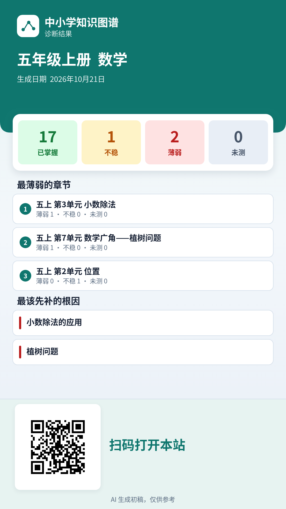

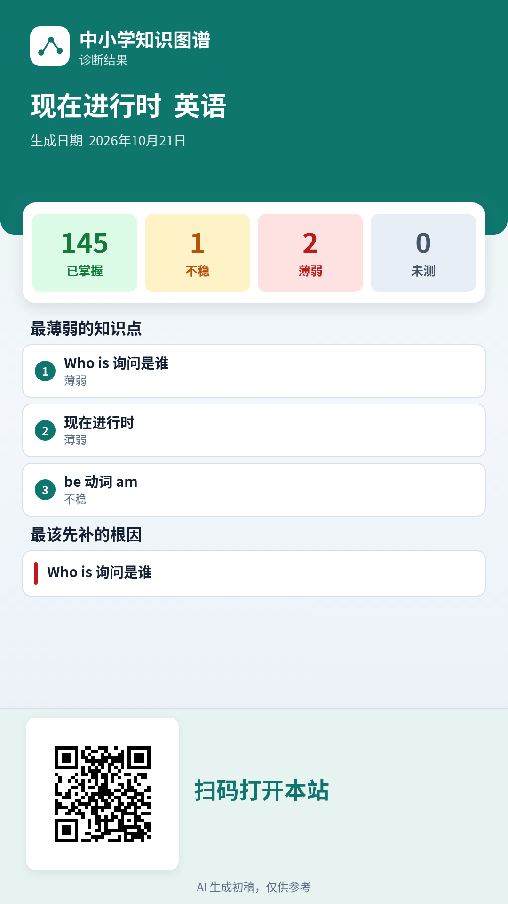

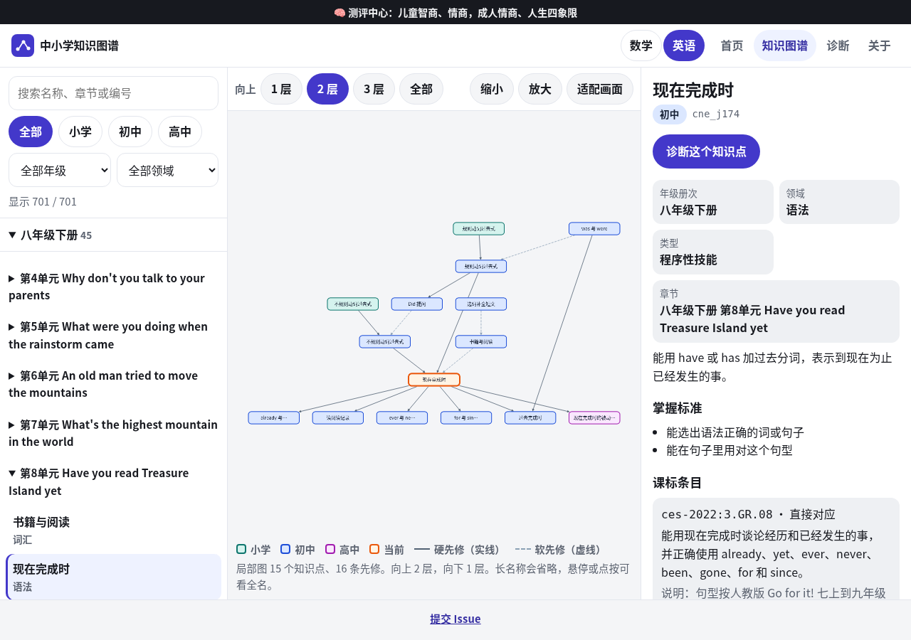

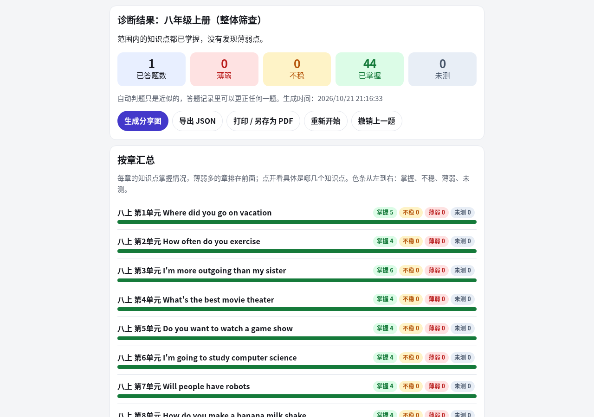

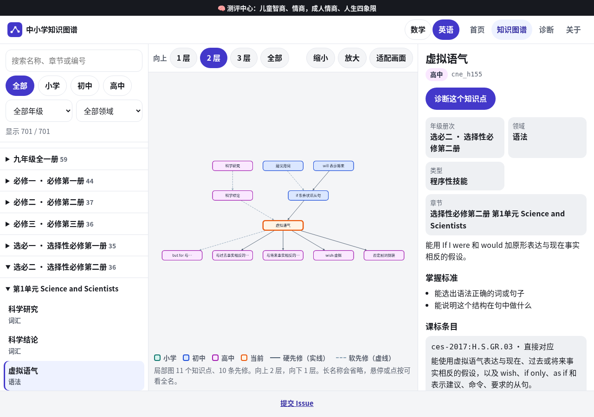

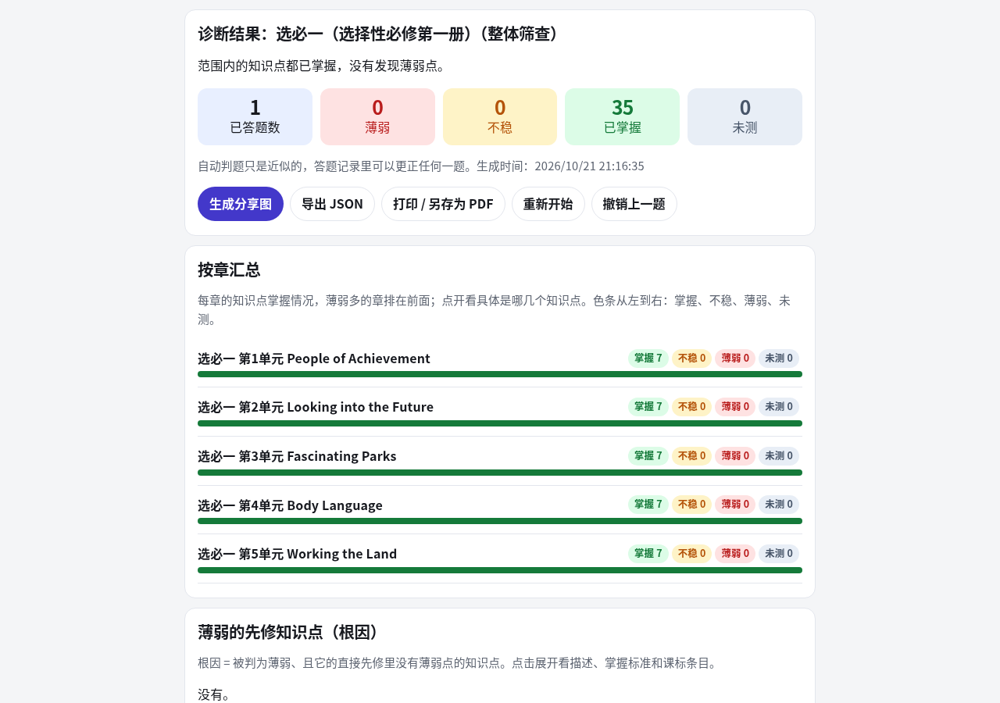

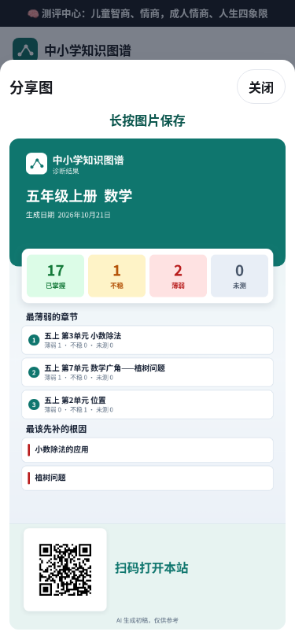

## Recommendations for Follow-Up

1. Ask primary-, junior-high-, and senior-high mathematics teachers to review the prerequisite edges first (especially hard edges, the 45 junior-high → primary edges, the 54 senior-high required cross-stage edges, and the 46 selective-compulsory cross-module edges). Use physical textbooks or official PEP directories to check Grade 9, second semester; all five senior-high volumes; and every primary-school volume marked “Unofficial; pending verification” in the table above, especially Grade 2, second semester. Teachers should also decide whether required Volume 2 should be labeled Grade 10, second semester, and whether selective-compulsory `grade` 12–14 should change. For English, check the PEP, Go for it!, and seven senior-high volume unit directories, as well as the 22 senior-high-English prerequisite edges pointing to junior high.
2. Ask curriculum experts to review the `standards` mappings (especially `inferred` mappings and clauses in Stages 1–3 that have not been checked page by page against the Ministry of Education PDF), and consider adding points for curriculum-standard clauses that still have no matching point.
3. Calibrate diagnostic questions and prerequisite strengths using real student response data.


## Deployment (Cloudflare Pages)

After updating this repository, run this command once locally to republish the static site:

```bash
./scripts/deploy-cf.sh
```

The script packages `index.html`, `sw.js`, `manifest.webmanifest`, `assets/` (including graph libraries and icons), `explore/`, `diagnose/`, `children/`, and the files used by the pages in `data/`, then deploys them to the `main` production branch on Cloudflare Pages. It does not modify the VPS / Caddy. Screenshots and question-generation batches are not included in the deployment package.
